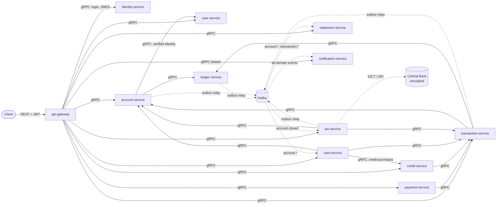
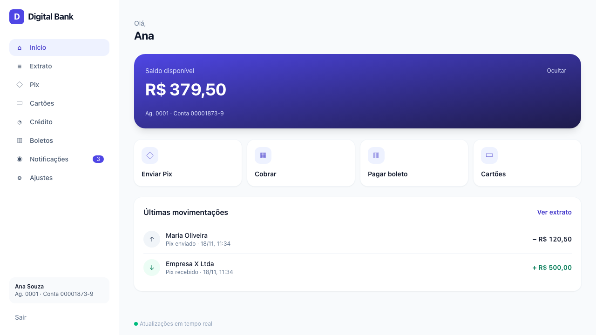
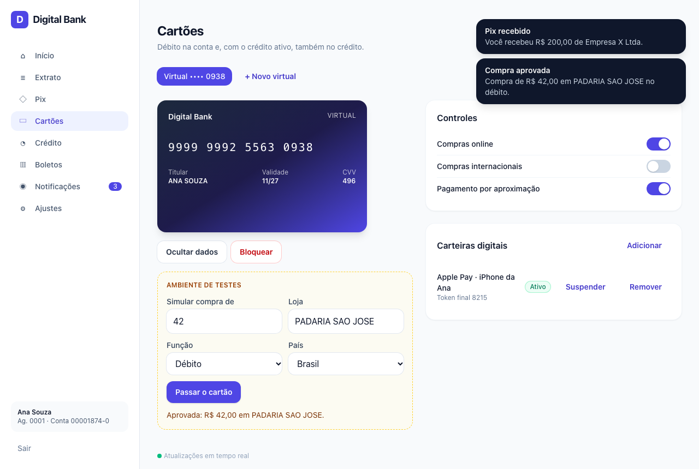
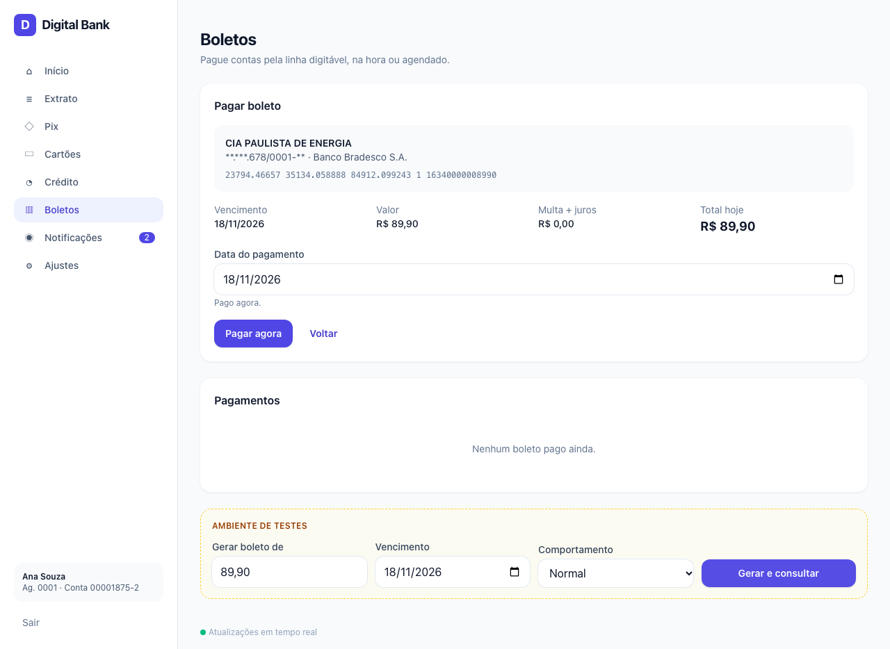
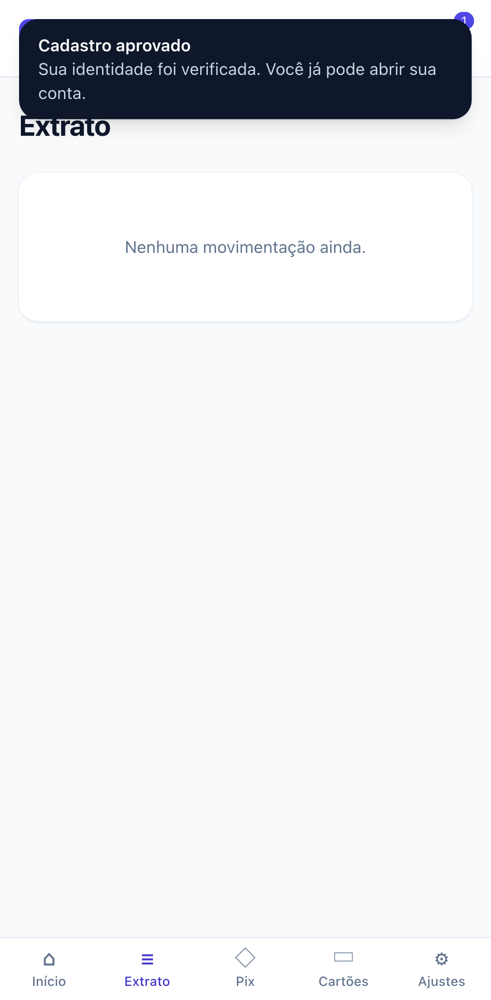

# Digital Bank Platform

A digital bank built in **Go** as event-driven microservices: checking accounts, a double-entry ledger, transfers, **Pix** (Brazil's instant payments) and a customer statement. It focuses on the parts that make money software hard: exact amounts, idempotency, concurrency, distributed consistency and observability.


```bash
make up     # dev certificates, Postgres, Kafka, Redis, 9 services, Jaeger, Prometheus
make demo   # a customer journey through the REST API
make e2e    # end-to-end tests against the running stack
```

## Architecture



Each service owns its PostgreSQL database and follows a hexagonal layout (`domain` → `application` → `ports` → `adapters`).

| Service | Responsibility |
|---|---|
| [ledger-service](docs/services/ledger-service.md) | Source of truth for money: balanced journal entries, holds, reversals |
| [account-service](docs/services/account-service.md) | Account lifecycle, CPF validation, per-transaction/daily/nightly limits |
| [transaction-service](docs/services/transaction-service.md) | Orchestrated sagas: transfers, two-phase Pix out, Pix in, recovery worker |
| [pix-service](docs/services/pix-service.md) | Pix keys, lookup, same-bank and cross-bank Pix, incoming Pix, BR Code QR codes, refunds |
| [card-service](docs/services/card-service.md) | Debit and credit cards: vault with encrypted PANs, derived CVVs, wallet tokens, real-time authorization, clearing, reversal |
| [credit-service](docs/services/credit-service.md) | Credit lines, holds for credit purchases, monthly invoices, payments, fines and interest |
| [user-service](docs/services/user-service.md) | Onboarding: profile with encrypted CPF, KYC against a simulated bureau (approve, reject, manual review); accounts open only for verified customers |
| [notification-service](docs/services/notification-service.md) | Notifications from domain events: in-app inbox, push / e-mail by preference, live Server-Sent Events across replicas |
| [payment-service](docs/services/payment-service.md) | Boletos: check digits, due date factor, overdue charges, payment now or scheduled through a two-phase saga |
| [statement-service](docs/services/statement-service.md) | CQRS read side: customer feed projected from Kafka |
| [identity-service](docs/services/identity-service.md) | Sign-up, login with argon2id + TOTP MFA, Ed25519 tokens via JWKS, rotating refresh tokens |
| [api-gateway](docs/services/api-gateway.md) | Public REST API: token verification, ownership checks, idempotency keys, rate limits |

## Web App

A customer app in [`apps/web`](apps/web) (React, TypeScript, Tailwind): onboarding with KYC, Pix, cards, credit, boletos and notifications that arrive live. `make up` serves it on http://localhost:8081.

| | |
|---|---|
|  |  |
|  |  |

## What Is Interesting Here

**Money is exact.** Amounts are `int64` minor units with overflow and currency checks; floats never appear, not even in JSON (`"amount": "10.50"`). → [`packages/go-common/money`](packages/go-common/money/money.go)

**The ledger cannot be wrong quietly.** Entries must sum to zero, checked in Go *and* by a deferred Postgres constraint trigger. Postings are append-only (enforced by triggers); corrections are reversals. Balance rows are locked with `SELECT … FOR UPDATE` in a fixed order, so concurrent transfers cannot deadlock or overdraw. A randomized concurrent test checks every invariant afterwards. Removing the row lock makes it fail. → [ledger tests](services/ledger-service/internal/application/service_test.go)

**Every retry is safe.** Each money-moving call carries an idempotency key plus a request fingerprint ([ADR-0016](docs/decisions/0016-idempotency.md)). The same key with a different request is rejected, not silently accepted.

**Sagas that recover.** Business refusals (insufficient funds, limit exceeded) compensate; technical failures (a service down) leave the saga in place, and a worker resumes it. A `PENDING` saga is never compensated from outside, because its last step may have succeeded with the response lost. Leases stop two runners from executing one saga. → [saga](services/transaction-service/internal/application/saga.go)

**Events without dual writes.** State and its event commit in one transaction (outbox). A relay publishes to Kafka with `FOR UPDATE SKIP LOCKED`. Consumers deduplicate with an inbox table in the same transaction as their effects, retry with backoff and dead-letter poison messages. → [events](docs/events/README.md)

**Pix, end to end.** Keys with real validation (CPF check digits, E.164 phones), lookup with masked documents, E2E IDs, cross-bank payments that reserve funds, record the SPI intent before calling it, then capture or release. BR Code QR codes ("copia e cola", EMV + CRC16) — static, one-time, and dynamic ones whose payload is a JWS signed by the bank — scheduled and recurring Pix, Pix Automático mandates, and refunds that can never exceed what was received, even concurrently. The Central Bank systems are simulated behind ports.

**Card authorization in milliseconds, safely.** A purchase is checked (status, expiry, CVV derived with an issuer key instead of stored, controls, MCC) and the money reserved through the same saga as Pix, in single-digit milliseconds at p99 locally. The authorization is recorded as "to be reversed" before any money moves, so a timeout answers `91` and a worker releases whatever was reserved. Card numbers live only in an encrypted vault. → [cards](docs/services/card-service.md)

**Authentication done properly.** Passwords hashed with argon2id, lockout, TOTP MFA with replay protection. Access tokens are Ed25519 JWTs: the gateway verifies them from a JWKS and cannot mint them. Refresh tokens rotate, and replaying an old one revokes the whole session. Signing keys and TOTP seeds are encrypted at rest. → [identity](docs/services/identity-service.md)

**Zero trust inside.** Services talk over mutual TLS 1.3 with SPIFFE identities, and each one authorizes its callers: the gateway's certificate gets `PERMISSION_DENIED` from the ledger. CPFs are encrypted at rest with a blind index (an expand/contract migration encrypted the existing rows), and rate limits are shared across gateway replicas through Redis. → [security](docs/architecture/security.md)

**Operable.** A KMS keeps master keys out of the services (envelope encryption, rotation, imported legacy keys), certificates rotate without restarts, a reconciliation job re-proves the ledger every few minutes, retention jobs keep tables small, and restarts are invisible to callers. A Helm chart (with NetworkPolicies mirroring the mTLS matrix) and AWS Terraform are validated in CI. → [deployment](docs/deployment.md)

**Observable.** One request is one trace across all services (OpenTelemetry → Jaeger). Correlation IDs travel through gRPC metadata and Kafka events. Prometheus metrics with low-cardinality labels, business counters, alert rules and a Grafana dashboard. → [observability](docs/architecture/observability.md)

## Getting Started

Requirements: Docker, Go 1.26+, `jq` for the demo.

```bash
make up      # build and start everything
make demo    # walk through the public API
```

```text
▶ Ana's statement (built asynchronously from Kafka events)
2026-11-17T16:56:09  D     80.00  PIX_OUT  Maria Oliveira
2026-11-17T16:56:09  D    120.00  INTERNAL_TRANSFER  Bruno Lima
2026-11-17T16:56:09  C    500.00  PIX_IN  Empresa X
```

| URL | |
|---|---|
| http://127.0.0.1:8000 | REST API ([reference](docs/api/README.md)) |
| http://127.0.0.1:16686 | Jaeger traces |
| http://127.0.0.1:9090 | Prometheus (metrics, alerts) |
| http://127.0.0.1:3000 | Grafana (`make up-obs`) |

Internal gRPC services listen on `:9001`–`:9007` over mTLS, with reflection enabled:

```bash
grpcurl -cacert infrastructure/certs/ca.pem -cert infrastructure/certs/dev-client.pem \
  -key infrastructure/certs/dev-client-key.pem 127.0.0.1:9001 list
```

## Tests

```bash
make test   # unit + integration (real Postgres, one fresh database per test)
make e2e    # black-box tests against docker compose, over gRPC, Kafka and REST
make lint   # gofmt, go vet, buf lint
```

- **Domain**: pure Go, no I/O (ledger rules, limits and the night window, CPF, Pix keys, E2E IDs).
- **Integration**: every repository and use case against PostgreSQL, including concurrency tests (N parallel debits, parallel limit consumption, concurrent saga runs) and a randomized invariant check.
- **End to end**: transfers, two-phase Pix, refusals with compensation, events reaching Kafka with the right correlation ID, Kafka consumers removing keys of closed accounts, the statement converging, and the public API's authorization.

CI runs lint, a check that generated code is up to date, all tests with Postgres, Docker builds of every service, and the e2e suite plus the demo against docker compose.

## Repository

```text
contracts/      Protobuf (buf) + generated Go code
packages/       go-common (money, document) · go-platform (postgres, outbox, inbox, kafka, grpcserver, telemetry…)
services/       one Go module per service
tests/e2e/      end-to-end tests
infrastructure/ Helm chart, Terraform (AWS), Postgres init, Prometheus, alerts, Grafana
docs/           architecture, services, events, API, ADRs, roadmap
```

What is done and what comes next: [ROADMAP.md](docs/ROADMAP.md). Decisions: [ADRs](docs/decisions/README.md).

## License

[MIT](LICENSE)
