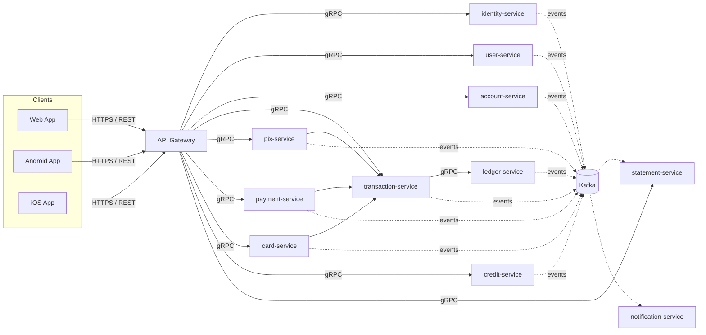

# Digital Bank Platform

> A cloud-native digital banking platform built with **Go** and a microservices architecture. It covers checking accounts, Pix instant payments, credit and debit cards, bill payments and statements.


---

## Table of Contents

- [Overview](#overview)
- [Features](#features)
- [Performance Targets](#performance-targets)
- [Architecture](#architecture)
- [Scalability](#scalability)
- [Services](#services)
- [Tech Stack](#tech-stack)
- [Repository Structure](#repository-structure)
- [Getting Started](#getting-started)
- [Documentation](#documentation)
- [Roadmap](#roadmap)
- [Contributing](#contributing)
- [License](#license)

---

## Overview

This project implements the core of a modern digital bank as a set of independent, event-driven services. The main goals are:

- **Correctness first**: every money movement goes through a **double-entry ledger**, which is the single source of truth for balances.
- **Resilience**: services talk asynchronously through events and use the **transactional outbox**, **idempotency keys** and **sagas** to stay consistent without distributed transactions.
- **Scale**: designed for tens of millions of customers, with horizontal scaling, separate read and write paths, and data sharded by customer.
- **Low latency**: every critical flow has a latency budget in milliseconds.
- **Observability**: logs, metrics and traces (OpenTelemetry) are built in from day one.
- **Security**: zero-trust internal communication, encrypted sensitive data and an isolated card data vault.

## Features

| Domain | Capabilities |
|---|---|
| Onboarding | Sign-up, KYC (Know Your Customer) verification, profile management |
| Identity | Login, MFA, JWT access/refresh tokens, device binding, session management |
| Accounts | Opening, blocking and closing checking accounts; balances; limits |
| Pix | Key registration (CPF, email, phone, random), transfers, static and dynamic QR codes |
| Payments | Bill (boleto) payments, scheduled payments, bank transfers |
| Cards | Virtual and physical debit and credit cards, purchase authorization, block and unblock |
| Credit | Credit limits, monthly invoices, installments, interest calculation |
| Statements | Real-time transaction history, monthly statements, PDF export |
| Notifications | Push, email and SMS triggered by domain events |

## Performance Targets

Designed for **100 M customers**, **30 M daily active users**, **100k RPS** of reads and **20k TPS** of financial writes at peak, with 3× headroom.

| Operation | p95 | p99 |
|---|---|---|
| Get balance | 30 ms | 50 ms |
| Transaction feed (first page) | 60 ms | 100 ms |
| Internal transfer | 100 ms | 200 ms |
| Create Pix transfer (accepted) | 150 ms | 300 ms |
| Card authorization | 100 ms | **200 ms** |
| Ledger posting | 15 ms | 30 ms |
| Pix end-to-end settlement | 2 s | 5 s |
| Transaction visible in the feed | 1 s | 3 s |

| Availability | Target |
|---|---|
| Tier 0 (ledger, Pix, card authorization, login) | 99.99% |
| Tier 1 (accounts, payments, credit, feed) | 99.95% |
| Ledger data loss (RPO) | 0 |

Full list: [docs/architecture/requirements.md](docs/architecture/requirements.md).

## Architecture



- **External API**: REST/JSON exposed only by the API Gateway and described in OpenAPI.
- **Internal API**: gRPC with Protocol Buffers between services.
- **Async communication**: domain events on Kafka, published through the transactional outbox.
- **Data**: one PostgreSQL database per service. No service reads another service's database.

See [docs/architecture](docs/architecture/overview.md) for details.

## Scalability

| Concern | Approach |
|---|---|
| Compute | Stateless Go services, Kubernetes HPA (CPU/RPS) and KEDA (Kafka lag), at least 3 replicas across 3 AZs |
| Writes | PostgreSQL **primary** per shard, synchronous standby in another AZ, PgBouncer pooling |
| Reads | **Read replicas** (`DB_READ_URL`), CQRS projections in `statement-service`, Redis cache |
| Data growth | Sharded by `customer_id` (4,096 logical shards), monthly table partitioning, cold storage |
| Blast radius | **Cell-based architecture**: independent stacks, each serving a subset of customers |
| Messaging | Kafka topics with 64–256 partitions keyed by account, idempotent consumers |
| Overload | Rate limiting, priority-based load shedding, circuit breakers, timeouts on every call |
| Hot accounts | Internal ledger accounts split into sub-accounts to avoid lock contention |

Money decisions (balance checks, limits, idempotency) **always** read from the primary. Display data can come from replicas or cache.

See [docs/architecture/scalability.md](docs/architecture/scalability.md).

## Services

| Service | Responsibility | Docs |
|---|---|---|
| `api-gateway` | Single entry point: routing, authentication, rate limiting | [link](docs/services/api-gateway.md) |
| `identity-service` | Credentials, MFA, tokens, sessions and devices | [link](docs/services/identity-service.md) |
| `user-service` | Customer profile, onboarding and KYC | [link](docs/services/user-service.md) |
| `account-service` | Checking account lifecycle and limits | [link](docs/services/account-service.md) |
| `ledger-service` | Double-entry ledger, source of truth for balances | [link](docs/services/ledger-service.md) |
| `transaction-service` | Orchestrates money movements (sagas) | [link](docs/services/transaction-service.md) |
| `pix-service` | Pix keys, transfers and QR codes | [link](docs/services/pix-service.md) |
| `payment-service` | Bill payments, scheduled payments, transfers | [link](docs/services/payment-service.md) |
| `card-service` | Card issuing, authorization and controls | [link](docs/services/card-service.md) |
| `credit-service` | Credit limits, invoices, installments and interest | [link](docs/services/credit-service.md) |
| `statement-service` | Read models for history and statements (CQRS) | [link](docs/services/statement-service.md) |
| `notification-service` | Push, email and SMS delivery | [link](docs/services/notification-service.md) |

## Tech Stack

| Layer | Technology |
|---|---|
| Language | Go 1.23+ |
| Internal communication | gRPC + Protocol Buffers ([buf](https://buf.build)) |
| External API | REST + OpenAPI 3.1 |
| Messaging | Apache Kafka (events), with schemas versioned in `contracts/events` |
| Databases | PostgreSQL 17 (one per service, primary + read replicas), PgBouncer, Redis Cluster |
| Data access | `pgx` + `sqlc` (type-safe SQL), `golang-migrate` |
| Observability | OpenTelemetry, Prometheus, Grafana, Loki, Jaeger, Pyroscope |
| Containers | Docker, Docker Compose (local), Kubernetes (Helm/Kustomize) |
| Autoscaling | Kubernetes HPA, KEDA, Karpenter |
| Testing | Go `testing`, Testcontainers, k6 (load), Chaos Mesh |
| Infrastructure as Code | Terraform |
| CI/CD | GitHub Actions |
| Clients | Web app; native Android and iOS apps |

## Repository Structure

```text
.
├── .github/workflows/      # CI/CD pipelines (lint, test, build, deploy)
├── apps/                   # Client applications
│   ├── web/                # Web banking
│   └── mobile/
│       ├── android/
│       └── ios/
├── contracts/              # Source of truth for every interface
│   ├── proto/              # gRPC / Protobuf definitions
│   ├── openapi/            # Public REST API specs
│   └── events/             # Event schemas (JSON Schema / Protobuf)
├── docs/                   # Architecture, services, ADRs, API, events, database
├── infrastructure/
│   ├── databases/          # Init scripts, local seeds
│   ├── docker/             # Dockerfiles and docker-compose for local dev
│   ├── kubernetes/         # Manifests / Helm charts
│   ├── messaging/          # Kafka topics and config
│   ├── monitoring/         # Prometheus, Grafana dashboards, alerts
│   ├── scripts/            # Infra helper scripts
│   └── terraform/          # Cloud infrastructure
├── packages/               # Shared Go libraries
│   ├── go-common/          # Money, IDs, pagination, time and other helpers
│   ├── go-errors/          # Typed domain errors and gRPC/HTTP mapping
│   ├── go-logger/          # Structured logging (slog)
│   ├── go-messaging/       # Kafka producer/consumer, outbox, inbox
│   ├── go-observability/   # OpenTelemetry tracing and metrics setup
│   └── go-security/        # JWT, mTLS, encryption, hashing
├── scripts/                # Developer scripts (codegen, migrations, bootstrap)
└── services/               # Go microservices (one folder per service)
```

Each service follows the same layout (hexagonal architecture):

```text
services/<name>/
├── cmd/server/             # main.go: wiring and startup
├── internal/
│   ├── domain/             # Entities, value objects, domain rules (no dependencies)
│   ├── application/        # Use cases / command and query handlers
│   ├── ports/              # Interfaces (repositories, publishers, clients)
│   └── adapters/
│       ├── grpc/           # Inbound gRPC handlers
│       ├── postgres/       # Repository implementations
│       └── kafka/          # Event publishers and consumers
├── migrations/             # SQL migrations
├── config/                 # Configuration loading
├── Dockerfile
└── go.mod
```

## Getting Started

> 🚧 The platform is under active development. The commands below show the planned developer workflow.

### Prerequisites

**Required**

| Tool | Version | Purpose |
|---|---|---|
| [Go](https://go.dev/dl/) | 1.23+ | Build and run services |
| [Docker](https://docs.docker.com/get-docker/) + Docker Compose | 24+ / v2 | Local infrastructure |
| `make` | any | Developer commands |
| [`buf`](https://buf.build/docs/installation) | 1.x | Protobuf linting and code generation |
| [`sqlc`](https://docs.sqlc.dev/) | 1.x | Type-safe SQL code generation |
| [`golang-migrate`](https://github.com/golang-migrate/migrate) | 4.x | Database migrations |
| [`golangci-lint`](https://golangci-lint.run/) | 1.6x+ | Linting |

**Optional**

| Tool | Purpose |
|---|---|
| [`k6`](https://k6.io/) | Load testing |
| [`kubectl`](https://kubernetes.io/docs/tasks/tools/) + [`kind`](https://kind.sigs.k8s.io/) | Local Kubernetes cluster |
| [Terraform](https://developer.hashicorp.com/terraform/install) 1.6+ | Cloud infrastructure |
| [`grpcurl`](https://github.com/fullstorydev/grpcurl) | Calling gRPC services manually |

**Machine**

- 16 GB RAM recommended (at least 8 GB allocated to Docker) to run the full stack locally
- 4+ CPU cores
- ~20 GB free disk space

### Running locally

```bash
# 1. Clone the repository
git clone <repository-url>
cd <repository>

# 2. Start infrastructure (PostgreSQL, Kafka, Redis, observability stack)
make infra-up

# 3. Generate code from contracts
make generate

# 4. Run database migrations
make migrate

# 5. Start all services
make run
```

| Tool | URL |
|---|---|
| API Gateway | http://localhost:8080 |
| Grafana | http://localhost:3000 |
| Jaeger | http://localhost:16686 |
| Kafka UI | http://localhost:8085 |

### Running tests

```bash
make test             # unit tests
make test-integration # integration tests (Testcontainers)
make lint             # golangci-lint
```

## Documentation

| Topic | Link |
|---|---|
| Documentation index | [docs/README.md](docs/README.md) |
| Non-functional requirements | [docs/architecture/requirements.md](docs/architecture/requirements.md) |
| Scalability | [docs/architecture/scalability.md](docs/architecture/scalability.md) |
| Architecture overview | [docs/architecture/overview.md](docs/architecture/overview.md) |
| Architectural patterns | [docs/architecture/patterns.md](docs/architecture/patterns.md) |
| Security | [docs/architecture/security.md](docs/architecture/security.md) |
| Observability | [docs/architecture/observability.md](docs/architecture/observability.md) |
| API guidelines | [docs/api/README.md](docs/api/README.md) |
| Event catalog | [docs/events/README.md](docs/events/README.md) |
| Database guidelines | [docs/database/README.md](docs/database/README.md) |
| Architecture Decision Records | [docs/decisions/README.md](docs/decisions/README.md) |

## Roadmap

- [ ] **Phase 1: Foundation**
  - [ ] Shared packages (`go-common`, `go-errors`, `go-logger`, `go-observability`)
  - [ ] Local infrastructure with Docker Compose
  - [ ] CI pipeline (lint, test, build)
- [ ] **Phase 2: Core banking**
  - [ ] `identity-service` and `user-service`
  - [ ] `account-service`
  - [ ] `ledger-service` (double-entry)
  - [ ] `transaction-service` (internal transfers)
  - [ ] `api-gateway`
- [ ] **Phase 3: Payments**
  - [ ] `pix-service` (simulated central bank integration)
  - [ ] `payment-service` (boletos, scheduled payments)
  - [ ] `statement-service`
  - [ ] `notification-service`
- [ ] **Phase 4: Cards and credit**
  - [ ] `card-service`
  - [ ] `credit-service`
- [ ] **Phase 5: Clients and production readiness**
  - [ ] Web app
  - [ ] Mobile apps
  - [ ] Kubernetes manifests and Terraform
  - [ ] Read replicas and PgBouncer in every environment
  - [ ] Load testing at 1× and 3× peak (k6) and chaos testing
- [ ] **Phase 6: Large scale**
  - [ ] Sharding by customer (logical shards + shard directory)
  - [ ] Cell-based deployment
  - [ ] Multi-region (active-passive, then active-active by cell)

## Contributing

See [CONTRIBUTING.md](CONTRIBUTING.md).

## License

This project is licensed under the MIT License. See [LICENSE](LICENSE).

> **Disclaimer:** This is an educational project. It is not affiliated with any financial institution and does not process real money. External systems such as the central bank's Pix infrastructure and card networks are simulated.
