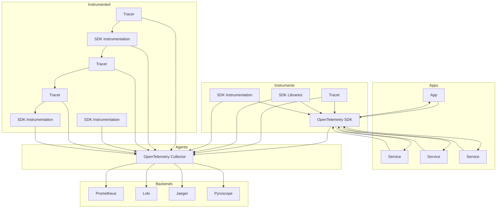

# Observability Architecture

This document describes the observability architecture of the Digital Bank Platform. The first section is what runs today in `docker compose`; the rest is the target design for production.

## Implemented

| Signal | How | Where |
|---|---|---|
| **Logs** | JSON (`log/slog`) on stdout. Every gRPC/HTTP request logs method/route, status, duration, `correlation_id` and `trace_id`. | `docker compose logs` |
| **Traces** | OpenTelemetry on every gRPC server/client and on the gateway; exported over OTLP to Jaeger. One request shows up as one trace across gateway → pix → transaction → account → ledger. | Jaeger: http://127.0.0.1:16686 |
| **Metrics** | Prometheus, scraped every 5 s from each service's `/metrics`. | Prometheus: http://127.0.0.1:9090 |
| **Dashboards** | Grafana with provisioned datasources and an overview dashboard (`make up-obs`). | http://127.0.0.1:3000 |
| **Alerts** | Prometheus rules in [`alerts.yml`](../../infrastructure/monitoring/prometheus/alerts.yml): gRPC error rate, ledger write p99 > 200 ms, outbox relay failing, dead-lettered events, spike of failed transactions. | Prometheus → Alerts |

Metrics exported (labels kept low-cardinality, never IDs):

| Metric | Labels |
|---|---|
| `grpc_server_handled_total`, `grpc_server_handling_seconds` | `method`, `code` |
| `http_requests_total`, `http_request_duration_seconds` | `route` (pattern, e.g. `POST /v1/accounts/{id}/transfers`), `status` |
| `outbox_published_total`, `outbox_publish_errors_total` | per instance |
| `events_consumed_total` | `type`, `outcome` (`ok`, `retry`, `dead_letter`) |
| `bank_business_events_total` | `event` (e.g. `transaction.completed`), `kind` (transaction type / Pix status) |

Correlation: the gateway accepts or creates `X-Correlation-ID`; it travels in gRPC metadata (`x-correlation-id`), is written into every event envelope, and is restored by Kafka consumers. Traces use W3C `traceparent`.

Code: `packages/go-platform/telemetry`, `packages/go-platform/grpcserver`, `services/api-gateway/internal/httpapi/middleware.go`.

---

## Overview

Observability is built into the platform from day one. We follow the **Three Pillars of Observability**:
- **Metrics**: Quantitative measurements over time
- **Logs**: Categorized events
- **Traces**: Request-level request flows

### Goals

- **Detect** issues quickly
- **Diagnose** problems efficiently
- **Prevent** future issues proactively
- **Comply** with regulatory requirements

## Components



## Instrumentation

### OpenTelemetry SDK

Each service uses the OpenTelemetry SDK:
```go
// go-observability package
import (
    "go-observability/otlp"
)

// Initialize
exporter, err := otlp.NewExporter(
    otlp.WithEndpoint(os.Getenv("OTEL_EXPORTER_OTLP_ENDPOINT")),
    otlp.WithHeaders(map[string]string{
        "X-Scope-Otc-Locale": os.Getenv("OTEL_RESOURCE_ATTRIBUTES"),
    }),
    otlp.WithHeaders(map[string]string{
        "X-Scope-Otc-Tenant": "prod",
    }),
)
```

### Service Initialization

```go
// services/identity-service/cmd/server/main.go
func main() {
    serviceExporter, _ := otlp.NewExporter(
        otlp.WithService("identity-service"),
        otlp.WithVersion("1.0.0"),
        otlp.WithResourceAttributes(map[string]any{
            "service.name":     "identity-service",
            "service.version":  "1.0.0",
            "service.instance.id": "unique-instance-id",
        }),
    )

    setupTracer(serviceExporter)
    setupMeter(serviceExporter)
    setupSampler(serviceExporter)

    app.Use(observability.Middleware())
    app.Use(observability.Recovery())

    app.Run(port)
}
```

### Structured Logging

```go
// go-logger package
import "go-logger/logger"

// Structured logging
log.Info("User login",
    http.Method("POST"),
    http.Path("/auth/login"),
    http.Status(200),
    http.Duration(125, "ms"),
    "customer_id", customer.ID,
    logger.Correlation(ctx.CorrelationID()),
    logger.TenantID(ctx.GetTenant()),
    "span.kind", "server",
    "span.id", fmt.Sprintf("%p", span.SpanContext.SpanContext()),
)
```

### Trace Context Propagation

```go
// Request context with trace context
// Headers:
// - otel-traceparent (W3C Trace Context)
// - otel-tracesubmission (submission id)
// - X-Correlation-Id (internal)

// Middleware
func Middleware() middleware.Middleware {
    return func(handler http.Handler) http.Handler {
        return http.HandlerFunc(func(w http.ResponseWriter, r *http.Request) {
            w = log.WithResponseWriter(w)

            span := otel.Tracer("app").Start(r.Context(), "HTTP")
            ctx := opentracing.ContextWithSpan(r.Context(), otel.SpanFromContext(span))

            r = opentracing.ContextToRequest(ctx, r)

            // Call handler with enriched context
            handler.ServeHTTP(w, r)

            span.End()
        })
    }
}
```

### Database Instrumentation

```go
// Database connection with trace context
db := sql.Open("postgres", dbUrl)
db.SetTraceContext(true)

// Query with instrumentation
stmt, err := sqlx.Prepare("SELECT * FROM users", db)
defer stmt.Close()

rows, err := stmt.QueryContext(ctx, params)

// Automatically creates span for query duration
// Logs: query, duration, error, row count
```

### gRPC Instrumentation

```go
// go-observability/grpc.go
type otelServerInterceptor struct {
    server otel.Tracer
}

func (interceptor *otelServerInterceptor) InterceptServer(srv interface{}, info *grpc.UnaryServerInfo, ...) interface{} {
    tracer := trace.NewTracer(srv)

    return otelgrpc.UnaryServerInterceptor(srv, info.FullMethodName, tracer)
}
```

### gRPC to HTTP Translations

gRPC method names are prefixed to create consistent traces:
- `GetUser` → `services/identity-service/users/service.User/get`
- `CreateUser` → `services/identity-service/users/service.User/create`

## Metrics

### Standard Metrics

| Metric | Description | Type |
|--------|-------------|------|
| `http_requests` | HTTP request counts | Counter |
| `http_request_duration` | HTTP request duration | Histogram |
| `grpc_calls` | gRPC calls | Counter |
| `grpc_call_duration` | gRPC call duration | Histogram |
| `auth_mfa_attempts` | MFA attempts | Counter |
| `auth_mfa_failures` | MFA failures | Counter |
| `account_balance_errors` | Balance errors | Counter |
| `ledger_post_latency` | Ledger posting | Histogram |
| `transaction_latency` | Transaction processing | Histogram |

### Business Metrics

| Metric | Description | Type |
|--------|-------------|------|
| `customers_active` | Active customers | Gauge |
| `accounts_opened_total` | Accounts opened | Counter |
| `accounts_closed_total` | Accounts closed | Counter |
| `transactions_processed` | Transactions | Counter |
| `pix_transfers` | Pix transfers | Counter |
| `payments_processed` | Payments | Counter |
| `card_authorizations` | Card authorizations | Counter |
| `credit_inquiries` | Credit inquiries | Counter |

### Infrastructure Metrics

| Metric | Description | Type |
|--------|-------------|------|
| `process_cpu_usage` | CPU usage | Gauge |
| `process_memory_usage` | Memory usage | Gauge |
| `process_open_fds` | Open file descriptors | Gauge |
| `kafka_consumer_lag` | Consumer lag | Gauge |
| `kafka_client_network` | Kafka network I/O | Counter |
| `postgresql_connections` | DB connections | Gauge |
| `redis_memory` | Redis memory usage | Gauge |
| `http_gateway_latency` | Gateway latency | Histogram |

### Alerts

| Metric | Threshold | Severity |
|--------|-----------|----------|
| `http_request_duration` (p99) | > 200 ms | Critical |
| `kafka_consumer_lag` | > 10000 | Warning |
| `postgresql_connections` / max_connections | > 0.8 | Critical |
| `auth_mfa_failures` / `auth_mfa_attempts` | > 0.2 | Warning |
| `ledger_post_latency` (p99) | > 50 ms | Critical |
| `grpc_call_duration` (p99) | > 200 ms | Warning |

## Logging

### Structured Logs

All logs are structured JSON:
```json
{
  "timestamp": "2025-01-15T10:30:00Z",
  "logger": "auth-service",
  "logger_version": "1.0.0",
  "level": "INFO",
  "correlation.id": "corr-123",
  "http.method": "POST",
  "http.path": "/auth/login",
  "customer_id": "cust-67890",
  "message": "User authenticated successfully",
  "duration.ms": 125,
  "error": null,
  "user.agent": "app/1.0.0",
  "user.ip": "192.168.1.100"
}
```

### Log Levels

| Level | Usage |
|-------|-------|
| `TRACE` | Detailed debugging info (local dev only) |
| `DEBUG` | Development debugging |
| `INFO` | Important events (user actions) |
| `WARN` | Potential issues |
| `ERROR` | Errors that need attention |

### Sampling Strategy

| Level | Rate |
|-------|------|
| `DEBUG` | 100% (local), 0% (prod) |
| `INFO` | 100% |
| `WARN` | 100% |
| `ERROR` | 100% |

### Log Rotation

```yaml
log_rotation:
  max_size: 100M  # Maximum log file size
  max_age: 30d    # Keep logs for 30 days
  max_backups: 7  # Keep 7 log files
  compress: true
```

## Tracing

### Trace Structure

```
Root Span (API Gateway)
  ├── Span (auth-service: Login)
  │   ├── Span (user-service: GetCustomer)
  │   └── Span (session-service: CreateSession)
  └── Span (account-service: CreateAccount)
      └── Span (ledger-service: PostEntries)
          └── Span (ledger-service: Commit)
```

### Span Attributes

| Attribute | Type | Purpose |
|-----------|------|---------|
| `service.name` | string | Service identifier |
| `service.version` | string | Service version |
| `service.instance.id` | string | Instance identifier |
| `service.namespace` | string | Namespace |
| `operation.name` | string | Operation name |
| `operation.id` | string | Operation identifier |
| `operation.type` | string | (sub, exec) |
| `operation.kind` | string | (server, client) |
| `http.method` | string | HTTP method |
| `http.status_code` | int | HTTP status code |
| `http.path` | string | Request path |
| `http.url` | string | Full URL |
| `http.user_agent` | string | User agent |
| `auth.method` | string | Authentication method |
| `customer.id` | string | Customer ID |
| `customer.cell.id` | string | Cell ID |
| `db.operation` | string | Database operation |
| `db.table` | string | Table name |
| `db.duration` | duration | Database duration |
| `db.rows` | int | Rows affected |
| `kafka.topic` | string | Kafka topic |
| `kafka.partition` | int | Kafka partition |
| `kafka.offset` | int | Kafka offset |
| `kafka.duration` | duration | Kafka duration |
| `ledger.entry.id` | string | Ledger entry ID |
| `ledger.amount` | decimal | Transaction amount |

### Tracing Headers

| Header | Format | Purpose |
|--------|--------|---------|
| `X-Correlation-Id` | `uuid` | Request correlation |
| `Traceparent` | `00-{trace_id}-{span_id}-{flags}` | W3C trace context |
| `Tracestate` | `{vendor}={value}` | Additional vendor context |
| `X-Span-Id` | `uuid` | Span identifier |

### Sampling Decisions

| Decision | Criteria |
|----------|----------|
| `AlwaysSample` | - parent sampled<br>- service is critical (ledger, auth)<br>- error occurred |
| `TraceIdRatio` | `0.01` (1% sampling) |
| `ParentSampled` | - parent sampled (100%) |
| `NeverSample` | - no parent<br>- development mode |

### Distributed Tracing

```
Client ──► API Gateway (trace) ──► Service A (continue trace)
                                      └──► Service B (continue trace)
                                      └──► Service C (continue trace)

Service A ──► Kafka (inject context) ──► Service B (extract context)
```

## Storage

### Metrics Storage

| Backend | Purpose | Retention |
|---------|---------|-----------|
| Prometheus | Time-series metrics | 15 days |
| Pyroscope | Continuous profiling | 7 days |

### Log Storage

| Backend | Purpose | Retention |
|---------|---------|-----------|
| Loki | Log aggregation | 7 days (hot), 30 days (cold) |
| Object Storage | Long-term archive | 365 days |

### Trace Storage

| Backend | Purpose | Retention |
|---------|---------|-----------|
| Jaeger | Trace search and UI | 7 days |

## Dashboarding

### Grafana Dashboards

| Dashboard | Purpose |
|-----------|---------|
| System Overview | Overall system health |
| API Performance | API request metrics |
| Auth Service | Authentication metrics |
| Account Service | Account operations |
| Ledger Service | Ledger posting performance |
| Transaction Service | Transaction processing |
| Database | PostgreSQL metrics |
| Kafka | Messaging metrics |
| Errors | Error rates and trends |

### Alerting

| Alert | Severity | Notification |
|-------|----------|--------------|
| Service Down | Critical | PagerDuty |
| Error Rate > 1% | Critical | PagerDuty |
| Latency p99 > 200ms | Warning | Email |
| Memory > 90% | Critical | PagerDuty |
| Disk > 85% | Warning | Email |

## Runbooks

### Common Issues

| Issue | Symptoms | Resolution |
|-------|----------|------------|
| Database connection pool exhausted | High connection errors | Scale up connections or fix leaks |
| Kafka consumer lag | Growing lag metric | Scale up consumers or increase throughput |
| High latency | Elevated latency metrics | Check database, network, or dependencies |
| Service not responding | No response in traces | Check pods, restart if healthy |
| High error rate | Rising error count | Check logs, fix root cause |

### Emergency Procedures

| Situation | Action |
|-----------|--------|
| Service completely down | Scale up other replicas |
| Database unresponsive | Trigger failover |
| Kafka down | Restart Kafka cluster |
| High latency | Scale horizontally or vertically |
| Cascading failures | Activate circuit breakers |

## Directory Structure

| File | Description |
|------|-------------|
| [observability.md](observability.md) | This observability architecture document |
| metrics.md | Metrics definitions and collection |
| tracing.md | Distributed tracing configuration |
| logging.md | Logging strategy and configuration |
| dashboards.md | Dashboard definitions |
| alerts.md | Alert rules and thresholds |
| runbooks.md | Operational runbooks |
