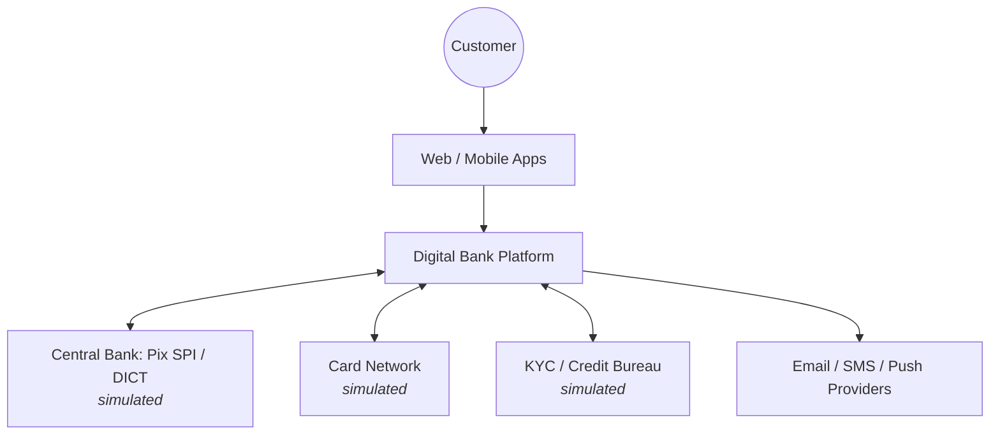
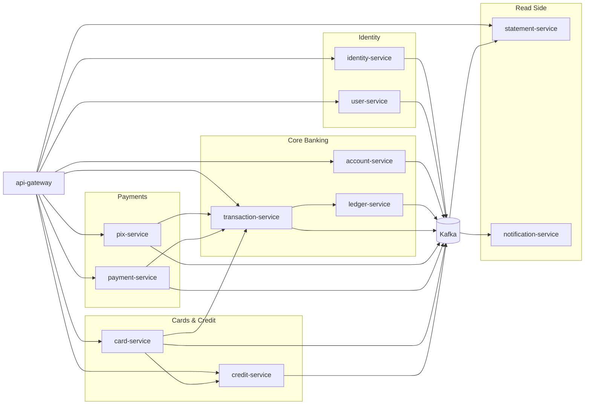
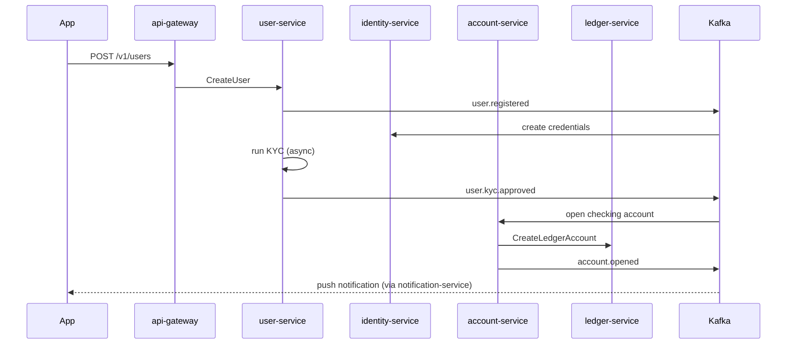
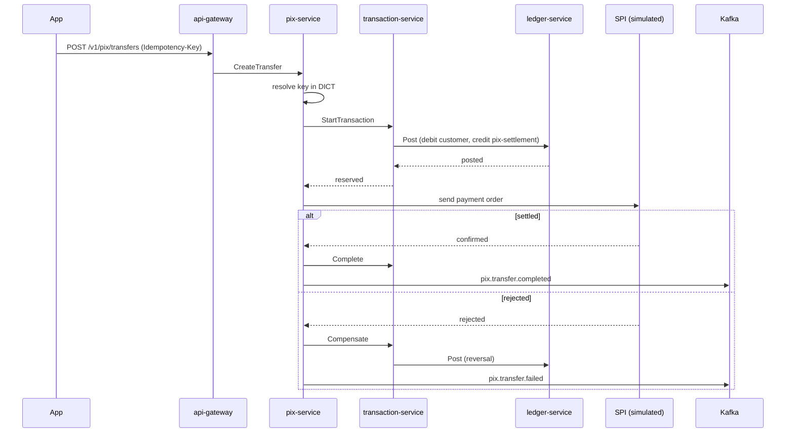
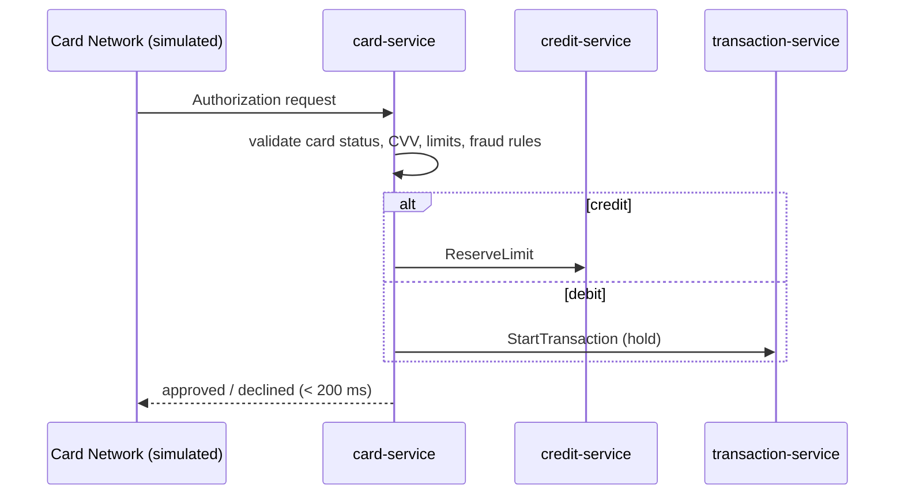

# Architecture Overview

## Principles

1. **The ledger is the source of truth.** Balances are never stored as a mutable field. They are derived from immutable double-entry postings.
2. **Each service owns its data.** One database per service, and other services never access it directly.
3. **Async by default, sync when necessary.** Commands that need an immediate answer, such as a balance check or a card authorization, use gRPC. Everything else reacts to events.
4. **Every write is idempotent.** Retries are expected at every layer.
5. **Contracts first.** Protobuf, OpenAPI and event schemas in `contracts/` are written before the implementation.
6. **Observable by design.** Every request carries a trace ID from the client to the database.
7. **Horizontally scalable.** Stateless services, separate read and write paths, and data partitioned by customer. See [scalability.md](scalability.md).
8. **Measurable targets.** Every flow has a latency budget in milliseconds. See [requirements.md](requirements.md).

## System Context

External integrations are implemented as **simulators** behind ports (interfaces), so they can be replaced by real adapters without changing domain code.

## Containers

| Bounded context | Services |
|---|---|
| Identity | `identity-service`, `user-service` |
| Core Banking | `account-service`, `ledger-service`, `transaction-service` |
| Payments | `pix-service`, `payment-service` |
| Cards & Credit | `card-service`, `credit-service` |
| Read Side | `statement-service`, `notification-service` |

## Communication

| Type | Technology | When to use |
|---|---|---|
| Client → Platform | REST/JSON over HTTPS | All client traffic, only through the gateway |
| Service → Service (sync) | gRPC over mTLS | Queries and commands that need an immediate result |
| Service → Service (async) | Kafka events | State changes, integrations and projections |

## Main Flows

### Customer onboarding

### Pix transfer (outgoing)

### Card purchase authorization

## Deployment

- **Local**: Docker Compose (`infrastructure/docker`)
- **Cloud**: Kubernetes (`infrastructure/kubernetes`) provisioned with Terraform (`infrastructure/terraform`)
- Each service is a stateless container that scales horizontally. State lives in PostgreSQL, Redis and Kafka.
- Production runs across 3 availability zones, with a cell-based layout for large scale. See [scalability.md](scalability.md#cell-based-architecture).
