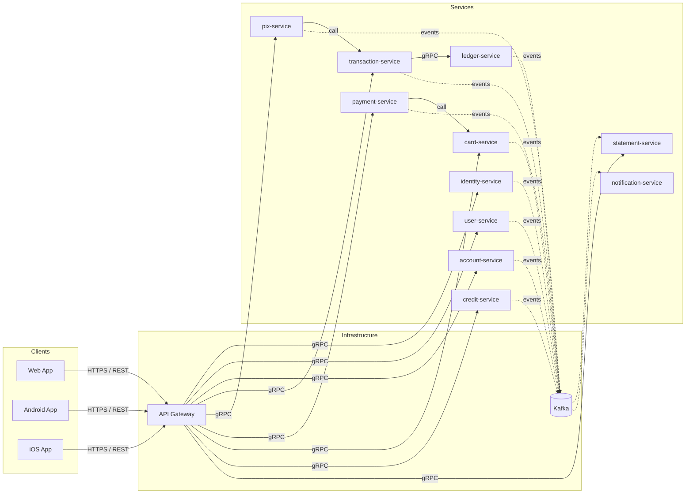

# Architecture Overview

This document describes the high-level architecture of the Digital Bank Platform.

## System Design

The platform is designed as a cloud-native, event-driven system optimized for financial transactions requiring strong consistency, high availability, and horizontal scalability.

## Key Architectural Principles

- **Double-Entry Ledger**: A dedicated ledger service maintains immutable journal entries, serving as the single source of truth for all balances.
- **Event-Driven Architecture**: Services communicate asynchronously via domain events published to Apache Kafka, enabling loose coupling and independent scaling.
- **Read-Write Separation**: Write operations target the primary database; reads may be served from read replicas, caches, or materialized views (CQRS).
- **Database Per Service**: Each service owns its database with no cross-service direct database access.
- **Stateless Services**: All services are stateless, enabling horizontal scaling and simplified deployment.
- **Zero-Trust Internal Communication**: Services authenticate and authorize each other using mutual TLS (mTLS).

## Technology Stack

| Layer | Technology |
|-------|-----------|
| Language | Go 1.26+ |
| Internal API | gRPC + Protocol Buffers |
| External API | REST + OpenAPI 3.1 |
| Messaging | Apache Kafka |
| Databases | PostgreSQL (one per service) |
| Cache | Redis Cluster |
| Infrastructure | Kubernetes, Terraform |
| Observability | OpenTelemetry + Prometheus + Grafana + Loki + Jaeger + Pyroscope |

## Repository Structure

```text
.
├── contracts/             # Protobuf contracts (buf) + generated Go code, one module
├── packages/
│   ├── go-common/         # money (exact amounts), document (CPF)
│   └── go-platform/       # postgres, pgtest, grpcserver, outbox, inbox, kafka, telemetry, correlation, config
├── services/              # one Go module per service, hexagonal layout
│   ├── api-gateway/       # ✅ public REST API
│   ├── ledger-service/    # ✅ double-entry ledger
│   ├── account-service/   # ✅ accounts and limits
│   ├── transaction-service/ # ✅ saga orchestrator
│   ├── pix-service/       # ✅ Pix (simulated DICT/SPI)
│   ├── statement-service/ # ✅ CQRS feed
│   ├── identity-service/  # ✅ authentication
│   ├── card-service/      # ✅ cards
│   ├── credit-service/    # ✅ credit lines and invoices
│   ├── payment-service/   # ✅ boletos
│   ├── kms-service/       # ✅ envelope encryption
│   └── …                  # user, notification: planned
├── tests/e2e/             # end-to-end tests against docker compose
└── infrastructure/        # docker (Postgres init), monitoring (Prometheus, alerts, Grafana)
```

Status of each service: [ROADMAP.md](../ROADMAP.md).

## Service Communication Diagram

Target architecture. Solid boxes in the [README](../../README.md#architecture) diagram are the ones running today.



## Key Architectural Components

### API Gateway
Single entry point for all external traffic. Responsibilities include:
- Request routing to appropriate services
- Authentication and token validation
- Rate limiting and throttling
- Request/response transformation
- API versioning

### Ledger Service
The **single source of truth** for all money movements. All balance changes are recorded as immutable double-entry journal entries:

- `credit_ledger`: Credits to an account (positive balance entry)
- `debit_ledger`: Debits from an account (negative balance entry)
- `account_ledger`: Net position of each account

See [docs/services/ledger-service.md](../services/ledger-service.md) for implementation details.

### Transaction Service
Orchestrates money-movement workflows using the Saga pattern:
- Internal transfers (debit one account, credit another)
- Pix transfers (initiate end-to-end Pix payments)
- Payment authorizations

Transactions publish events on completion (success or failure) for consumers to process.

### CQRS Projection
Some services maintain separate read models (projections) optimized for querying:
- Statement service maintains materialized views of transaction history
- Cache layer (Redis) for frequently accessed reference data

## Domain Events

Events are the glue between services. Every significant state change publishes one or more domain events:
- `UserCreated`, `UserVerified`, `SessionCreated`
- `AccountOpened`, `AccountClosed`
- `PixKeyRegistered`, `PixTransferInitiated`, `PixTransferSettled`
- `PaymentAuthorized`, `PaymentSettled`
- `CardIssued`, `CardAuthorized`, `CardBlocked`

See [docs/events/README.md](../events/README.md) for the complete event catalog.

## Data Consistency Model

### Strong Consistency
Ledger entries are written atomically using database transactions with row-level locks.

### Eventual Consistency
Downstream services (statements, notifications, analytics) consume events asynchronously. They may lag behind real-time but remain consistent within the SLA.

### Transactional Outbox Pattern
Each event is written to a database table in the same transaction as the event record. A separate process polls for committed outbox records and publishes them to Kafka.

See docs/architecture/consistency.md for detailed consistency guarantees.

## Deployment

### Local Development
- Docker Compose orchestration with individual service images
- Hot-reload for development services

### Production
- Kubernetes with Kustomize overlays per environment
- Horizontal Pod Autoscaling (CPU and RPS metrics)
- Cell-based sharding for horizontal scaling

See docs/architecture/deployment.md for deployment strategies.

## Documentation Index

| Document | Description |
|----------|-------------|
| [overview.md](./overview.md) | This overview of the architecture |
| [requirements.md](./requirements.md) | Functional and non-functional requirements |
| [scalability.md](./scalability.md) | Horizontal scaling strategies |
| [patterns.md](./patterns.md) | Architectural patterns used |
| [security.md](./security.md) | Security architecture and practices |
| [observability.md](./observability.md) | Observability and monitoring |

## Contributing

When contributing, ensure you update relevant architecture documentation. See [CONTRIBUTING.md](../../CONTRIBUTING.md) for contribution guidelines.
