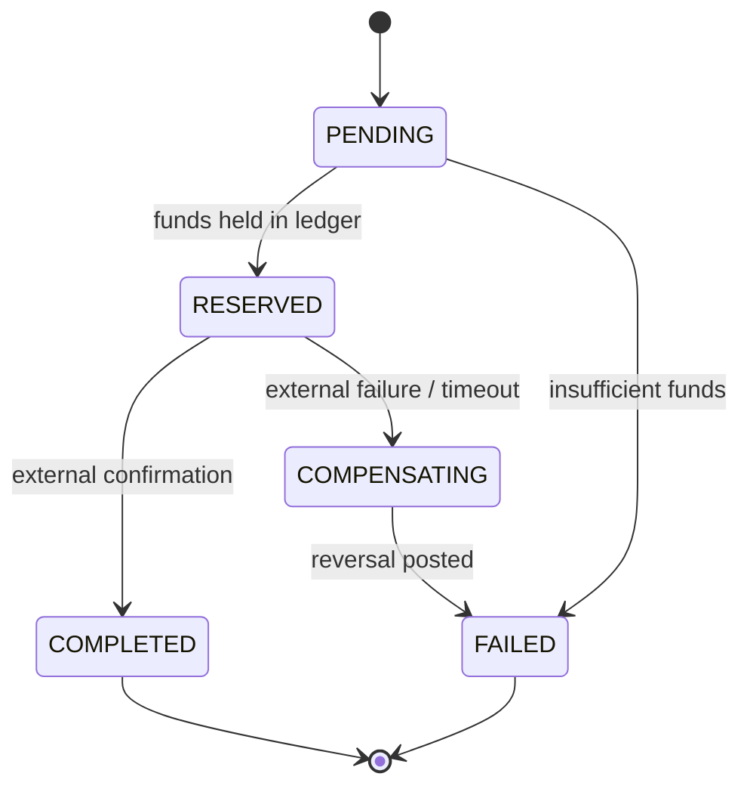

# Architectural Patterns

## Hexagonal Architecture (Ports and Adapters)

Every service isolates domain logic from infrastructure:

```text
           ┌────────────────────────────────────────┐
 gRPC ───▶ │ adapters/grpc                          │
 Kafka ──▶ │ adapters/kafka (consumer)              │
           │        │                               │
           │        ▼                               │
           │  application (use cases)               │
           │        │                               │
           │        ▼                               │
           │  domain (entities, rules)              │
           │        ▲                               │
           │        │ ports (interfaces)            │
           │  adapters/postgres, adapters/kafka     │ ───▶ DB / Kafka
           └────────────────────────────────────────┘
```

- `domain` depends on nothing.
- `application` depends only on `domain` and `ports`.
- `adapters` implement `ports` and are wired together in `cmd/server`.

## Double-Entry Ledger

Every money movement is a **journal entry** with two or more **postings** whose sum is zero.

```text
Transfer of R$ 50.00 from Alice to Bob

Journal Entry #9f3c...
  ├── DEBIT   alice:checking   -5000 BRL
  └── CREDIT  bob:checking     +5000 BRL
                               ─────────
                                   0  ✔
```

- Entries are **append-only**. Corrections are made with reversal entries, never with updates.
- Balances are computed from postings and cached in a balance snapshot that is updated in the same DB transaction.
- See [ledger-service](../services/ledger-service.md) and [ADR-0005](../decisions/0005-double-entry-ledger.md).

## Saga (Orchestration)

Money movements that span multiple services (Pix, card debit, bill payment) are coordinated by `transaction-service` as **orchestrated sagas**:



Each step has a **compensating action**. Saga state is persisted, so a saga can resume after a crash.

## Transactional Outbox

To publish events atomically with state changes:

1. In the same DB transaction, the service writes its aggregate **and** a row in the `outbox` table.
2. A relay (in `packages/go-messaging`) polls the outbox, or uses CDC, and publishes to Kafka.
3. The row is marked as published.

This guarantees **at-least-once** delivery with no dual-write problem. See [ADR-0007](../decisions/0007-transactional-outbox.md).

## Inbox / Idempotent Consumers

Consumers store processed `event_id`s in an `inbox` table, in the same transaction as their side effects. Duplicate events are ignored.

## Idempotency Keys

- Every state-changing public endpoint requires an `Idempotency-Key` header (UUID).
- The gateway and the services store `(key, request_hash, response)` for 24 hours.
- Same key with the same payload: the stored response is returned.
- Same key with a different payload: `409 Conflict`.

## CQRS

- **Write side**: domain services (`ledger`, `transaction`, `pix`, ...) handle commands.
- **Read side**: `statement-service` builds denormalized projections from events, optimized for the queries the app needs, such as the transaction feed, monthly statements and search.

## Resilience

| Concern | Approach |
|---|---|
| Timeouts | Every outgoing call has a context deadline |
| Retries | Exponential backoff with jitter, only for idempotent operations |
| Circuit breaker | Around external integrations (SPI, card network, providers) |
| Bulkheads | Separate worker pools per consumer group |
| Dead-letter queues | Each topic has a `.dlq` companion for poison messages |
| Graceful shutdown | Drain in-flight requests and commit consumer offsets before exiting |

## Optimistic Concurrency

Aggregates carry a `version` column. Updates use `WHERE version = $n`, and a conflict causes a retry of the use case.
