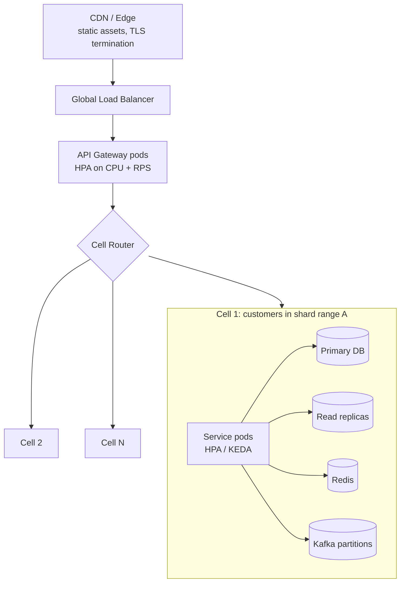
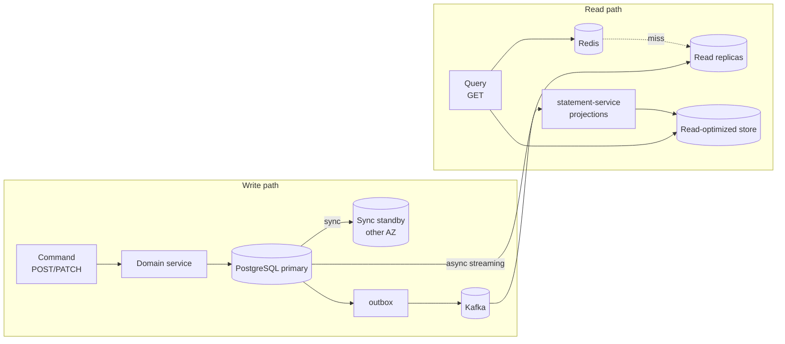
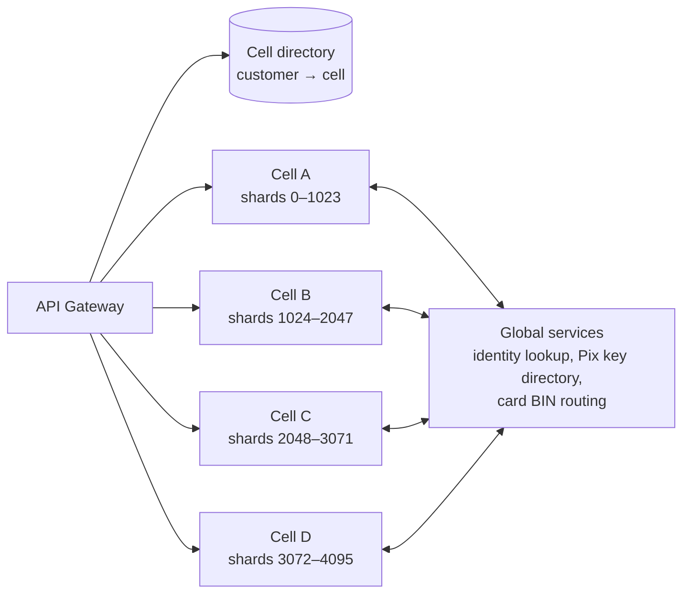

# Scalability

How the platform reaches the [non-functional requirements](requirements.md): tens of millions of customers, 100k RPS of reads and 20k TPS of financial writes, with room to grow 3× without redesign.

## Principles

1. **Scale out, not up.** Every component scales by adding instances, partitions or shards.
2. **Stateless compute.** Services keep no local state. Any pod can serve any request.
3. **Separate reads from writes.** Writes go to primaries. Reads go to replicas, projections and caches.
4. **Partition everything by customer.** `account_id` / `customer_id` is the partition key for databases, Kafka and cells.
5. **Async by default.** Only what must be synchronous sits on the request path.
6. **Limit the blast radius.** A failure affects one cell, shard or partition, never the whole bank.
7. **Shed load before failing.** Protect critical flows (card authorization, Pix) by degrading non-critical ones.

## Scaling Layers



| Layer | How it scales |
|---|---|
| Edge | CDN + global load balancer, HTTP/2 / HTTP/3 |
| API Gateway | Stateless pods, HPA on CPU and RPS |
| Services | Stateless pods, HPA (CPU/RPS) for gRPC, KEDA (consumer lag) for consumers |
| Databases | Read replicas for reads, sharding by customer for writes |
| Kafka | More partitions + more consumer replicas (up to the partition count) |
| Cache | Redis Cluster (hash slots), sharded by key |
| Whole stack | More **cells** |

## Stateless Services and Autoscaling

- No in-memory sessions or local files. State lives in PostgreSQL, Redis and Kafka.
- Kubernetes **HPA** on CPU (target 60%) and requests per second for gRPC/HTTP services.
- **KEDA** scales consumers on Kafka consumer lag.
- **Karpenter / Cluster Autoscaler** adds nodes when pods are pending.
- At least **3 replicas spread across 3 AZs** (`topologySpreadConstraints`), plus a **PodDisruptionBudget**.
- Pre-scaling before known peaks (paydays, Black Friday) through scheduled scaling.
- Go runtime tuning: `GOMAXPROCS` matched to the CPU limit (`automaxprocs`) and `GOMEMLIMIT` set to ~90% of the memory limit.

## Read / Write Separation

Writes and reads have different shapes. We separate them on three levels:



### Level 1: primary vs read replicas (inside each service)

| | Write database (primary) | Read database (replicas) |
|---|---|---|
| Used for | Commands, and any read that **decides** something about money | Display queries, lists, history |
| Consistency | Strong | Eventual (lag p99 < 500 ms) |
| Scaling | Sharding | Add replicas (up to ~5 per primary) |
| Connection string | `DB_WRITE_URL` | `DB_READ_URL` |

In code, each service has two connection pools and two kinds of repositories:

```go
// ports
type AccountCommandRepository interface { // primary pool
    Save(ctx context.Context, a *domain.Account) error
    GetForUpdate(ctx context.Context, id domain.AccountID) (*domain.Account, error)
}

type AccountQueryRepository interface { // replica pool
    GetView(ctx context.Context, id domain.AccountID) (*AccountView, error)
    List(ctx context.Context, owner domain.CustomerID, page Page) ([]AccountView, error)
}
```

**Rules:**

- A balance check before a debit, a limit check, or an idempotency check **always reads from the primary**.
- Screens (balance display, card list, profile) read from replicas or cache.
- **Read-your-writes**: write responses return the new state, so the client does not need to read again right away. When a follow-up read is needed, the gateway pins that customer's reads to the primary for a few seconds after a write (sticky-primary window).

### Level 2: CQRS projections

`statement-service` builds **denormalized read models** from events, shaped exactly for each screen. The feed query is a single indexed lookup and never joins data across services.

- Stored in PostgreSQL partitioned by month (and by customer shard).
- Can be moved to a wide-column store (Cassandra / ScyllaDB) if feed volume requires it, without changing write services.
- Full-text search (optional) is handled by OpenSearch fed from the same events.

### Level 3: cache

See [Caching](#caching).

## Partitioning and Sharding

### Partition key

`customer_id` (and `account_id`, which maps to a customer) is the partition key across the whole platform:

| Component | Partitioned by |
|---|---|
| Databases (shards) | `hash(customer_id) → logical shard` |
| Kafka topics | `account_id` / aggregate ID (keeps per-customer ordering) |
| Redis | Key prefix `{customer_id}` (same hash slot for one customer's keys) |
| Cells | Range of logical shards |

### Logical shards

- The key space is split into **4,096 logical shards**, mapped to a smaller number of physical database clusters.
- Moving a logical shard to a new cluster (rebalancing) is a data migration, not a code change.
- The `shard → cluster` map lives in a small, highly cached directory (config service / etcd, cached in each pod).

### Table partitioning (inside one database)

High-volume, append-only tables use PostgreSQL **declarative partitioning by time**:

| Table | Partitioning | Retention in OLTP |
|---|---|---|
| `postings`, `journal_entries` | Monthly range | 24 months (older data → cold storage) |
| `feed_items` | Monthly range | 24 months |
| `outbox`, `inbox` | Daily range | 7 days (dropping a partition is cheaper than `DELETE`) |
| `authorizations` | Monthly range | 18 months |

Data older than the OLTP retention moves to object storage (Parquet) for audit and analytics.

## Cell-Based Architecture

At large scale, the platform is deployed as multiple **cells**. A cell is a full, independent copy of the customer-scoped stack (services, databases, Redis, Kafka partitions) that serves a subset of customers.



- **Blast radius**: a bad deploy or a failed database affects only the customers in that cell. Deploys roll out cell by cell.
- **Linear scaling**: more customers → more cells. Each cell has a known, load-tested capacity (for example 10 M customers).
- **Global services** handle the few lookups that cannot be partitioned by customer: login by CPF, Pix key → account, card BIN → issuer.
- **Cross-cell transfers** (Alice in cell A pays Bob in cell B) use the same saga and event flow as any other transfer. The debit happens in cell A and the credit in cell B.

See [ADR-0010](../decisions/0010-sharding-and-cells.md).

## Ledger at Scale

The ledger is the hardest component to scale because it must be strongly consistent.

| Problem | Solution |
|---|---|
| Write volume | Sharded by customer. Each customer's ledger accounts live in their shard |
| **Hot accounts** (internal accounts such as Pix settlement or card clearing receive a posting for every transaction) | Split each internal account into **N sub-accounts** (for example 64), choose one by hash, and sum them for reporting |
| Lock contention on a customer's balance | Short transactions, row-level locks, fixed lock ordering, no network calls inside a DB transaction |
| Balance reads | Balance snapshot table updated in the same transaction (O(1) read), with no sum over postings at read time |
| History growth | Monthly partitions, with cold data moved to object storage |

## Kafka at Scale

- Partitions per high-volume topic: **64–256**. Rule of thumb: `partitions ≥ peak msg/s ÷ msg/s per consumer`, with 2× headroom.
- Consumer replicas ≤ partitions. KEDA scales them by lag.
- `acks=all`, `min.insync.replicas=2`, replication factor 3, idempotent producers.
- Batching and compression (`lz4` / `zstd`) on producers.
- Separate consumer groups per use case, so a slow consumer (exports) never delays a fast one (notifications).
- Dead-letter topics for poison messages, so one bad message never blocks a partition.

## Caching

| Layer | What | TTL / invalidation |
|---|---|---|
| CDN | Web app static assets, public config | Versioned URLs |
| Gateway (Redis) | JWKS, rate-limit counters, idempotency responses | Minutes / 24 h |
| Service (Redis) | Profile, card list, account view, displayed balance | Short TTL (5–30 s) + invalidation on domain events |
| Service (in-process) | Feature flags, limits configuration, shard map | Seconds, refreshed in the background |
| Pix | Key lookups (recipient name, bank) | Short TTL, invalidated on `pix.key.*` |

**Rules:**

- **Never use a cache for a money decision.** Debits, limit checks and idempotency checks read from the primary.
- Use cache-aside with **request coalescing** (`singleflight`) to avoid stampedes.
- Add TTL jitter to avoid mass expiry.
- The service must keep working, more slowly, if Redis is down.

## Database Connections

At scale, connection count is usually the first database limit hit.

- **PgBouncer** in transaction-pooling mode in front of every primary and replica.
- Rule: `pods × pool size per pod ≤ PgBouncer pool`, and `PgBouncer pool ≤ max_connections` with headroom.
- Go: `pgxpool` with explicit `MaxConns`, plus statement and lock timeouts on every query.
- Use `pgx` + `sqlc` (generated, type-safe SQL) instead of reflection-heavy ORMs.

## Protecting the System Under Load

| Technique | Where |
|---|---|
| **Rate limiting** | Gateway: per IP, user, device and endpoint |
| **Priority-based load shedding** | Gateway: when saturated, reject Tier 2 traffic (exports, history beyond page 1) before Tier 0 (card authorization, Pix, login) |
| **Adaptive concurrency limits** | Each service limits in-flight requests and rejects with `RESOURCE_EXHAUSTED` instead of queueing indefinitely |
| **Timeouts and deadlines** | Propagated through `context`. A request never waits longer than its budget |
| **Circuit breakers** | Around external systems and between services |
| **Bulkheads** | Separate pools per dependency and per consumer group |
| **Async offloading** | Heavy work (PDF statements, reports) goes to queues and the client is notified when it is ready |
| **Graceful degradation** | If `statement-service` is slow, the app shows the cached feed. If notifications are down, money flows continue |

## High Availability and Multi-Region

| Component | Within a region (3 AZs) | Across regions |
|---|---|---|
| Services | ≥ 3 replicas spread across AZs | Deployed in both regions |
| PostgreSQL | Primary + **synchronous standby** (other AZ) + async read replicas | Async replica in the secondary region |
| Kafka | RF = 3 across AZs | MirrorMaker 2 / cluster linking |
| Redis | Cluster with replicas across AZs | Rebuilt / warmed on failover |

- **Phase 1**: active-passive, with the secondary region on warm standby and failover RTO < 15 min.
- **Phase 2**: active-active **by cell**. Each cell has a home region, so writes for a customer happen in one region only, which avoids multi-master conflicts.

## Performance Engineering in Go

- Protobuf on the wire, with no JSON between services.
- Reuse buffers (`sync.Pool`) on hot paths and avoid allocations in loops.
- Continuous profiling (`pprof` / Pyroscope) in staging and production.
- Benchmarks (`go test -bench`) for hot code: ledger posting, authorization rules, serialization.
- HTTP/2 keep-alive connections and gRPC client-side load balancing (or a service mesh) to avoid hot pods.

## Capacity Planning

Each service documents:

1. Throughput per pod at the target latency (measured with load tests).
2. The resource that saturates first (CPU, DB connections, partitions).
3. The formula for replicas needed: `replicas = peak RPS ÷ RPS per pod × 1.5` (headroom), with a minimum of 3.

These numbers are reviewed every quarter and before known peak events.
