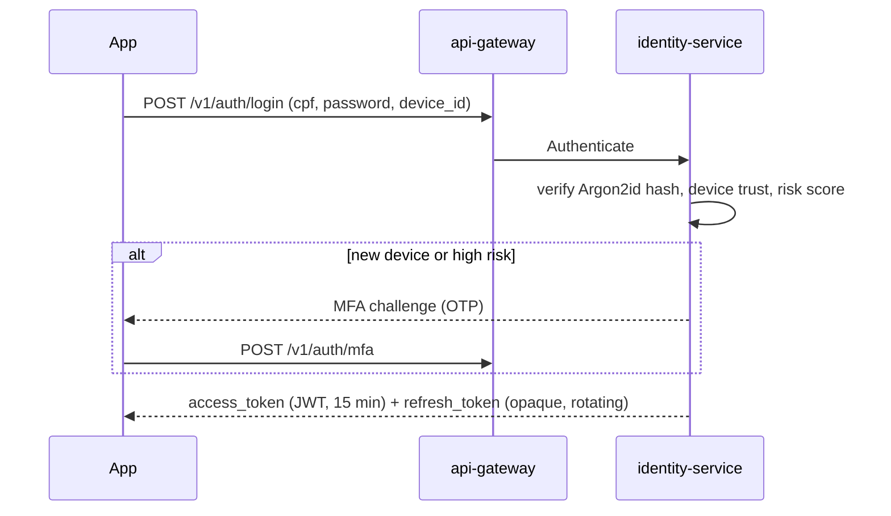

# Security

## Authentication

- **Access tokens**: short-lived JWTs (15 min), signed with asymmetric keys (EdDSA / ES256), validated at the gateway via JWKS.
- **Refresh tokens**: opaque, single use, rotated on every refresh. Reuse detection revokes the whole token family.
- **Passwords**: hashed with Argon2id.
- **MFA**: TOTP or OTP via SMS/email. Required for new devices and sensitive operations.
- **Device binding**: each session is tied to a registered device.

## Authorization

- The gateway checks token validity and scopes.
- Services enforce **resource ownership**: a customer can only access their own accounts, cards and transactions.
- Sensitive operations, such as large Pix transfers, adding a new Pix key or showing card details, require **step-up authentication**.

## Service-to-Service

- **mTLS** between all services (zero trust).
- The original user identity is propagated through gRPC metadata. Each service re-validates it.

## Data Protection

| Data | Protection |
|---|---|
| Passwords | Argon2id hash |
| PAN / CVV | Stored only in the card vault, encrypted with AES-256-GCM. CVV is never stored after issuing |
| CPF, phone, email | Encrypted at rest (envelope encryption) plus a blind index for lookups |
| Tokens / secrets | Kubernetes Secrets / external secret manager, never in the repository |
| Logs | PII masked by `go-logger` (for example `***.456.789-**`) |

## Card Data (PCI DSS-inspired)

- The card vault is an isolated module inside `card-service` with its own database and network policy.
- Other services only see **tokens** and the **last 4 digits**.

## API Protection

- Rate limiting per IP, per user and per endpoint (Redis, token bucket).
- Request size limits, strict input validation and CORS allow-list.
- Security headers (HSTS, CSP for the web app).

## Fraud Prevention

- Per-transaction and daily limits per account (configurable by the customer).
- Night-time Pix limits.
- Velocity rules on card authorizations and Pix transfers.

## Supply Chain

- `govulncheck` and dependency scanning in CI.
- Minimal, non-root, distroless container images.
- Image scanning before deploy.
