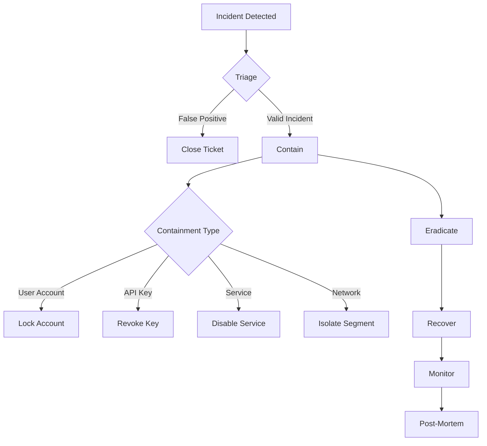

# Security Architecture

This document describes the security architecture of the Digital Bank Platform. The first section is what runs today; the rest is the target design.

## Implemented

| Control | Where |
|---|---|
| Passwords hashed with argon2id; lockout after 5 failures; equal cost for unknown emails | [identity-service](../services/identity-service.md) |
| TOTP MFA with replay protection | identity-service |
| Ed25519 access tokens (15 min) verified by the gateway from a JWKS; key rotation without downtime | identity-service, api-gateway |
| Rotating refresh tokens stored hashed, with reuse detection that revokes the session | identity-service |
| Secrets at rest (signing keys, TOTP seeds) encrypted with AES-256-GCM, bound to their row | `packages/go-platform/secretbox` |
| Object-level authorization: every account route checks ownership and answers 404 otherwise | [api-gateway](../services/api-gateway.md) |
| Rate limits per customer, and per IP on login/sign-up, shared by all replicas through Redis (GCRA, fails open) | api-gateway |
| Mutual TLS 1.3 between services with SPIFFE identities; each service authorizes its callers (e.g. only account- and transaction-service may call the ledger) | `packages/go-platform/mtls` |
| CPF encrypted at rest (AES-256-GCM bound to the account) with an HMAC blind index; legacy rows encrypted on startup | account-service |
| Strict input handling: unknown JSON fields rejected, 64 KiB bodies, decimal-string amounts, safe correlation IDs | api-gateway |
| Idempotency keys scoped per customer | api-gateway, [ADR-0016](../decisions/0016-idempotency.md) |
| No PII in events (ids only); documents masked in Pix lookups | all services |
| Ledger integrity in the database: balanced entries, append-only journal | ledger-service |
| Card numbers only in an encrypted vault with a blind index; CVVs derived from an issuer key, never stored | card-service |

Not yet: a KMS for the key-encryption keys, TLS for Postgres and Kafka, certificate rotation (dev certificates last 90 days), audit log shipping. See the [roadmap](../ROADMAP.md).

### Staff (back office)

Bank staff sign in through the same identity-service with role `ANALYST`, carried in the access token together with how the session was authenticated (`amr`: `pwd`, plus `otp` when TOTP is enabled).

- **MFA is mandatory.** The gateway's `/v1/backoffice/*` routes refuse any other role (403 `STAFF_ONLY`) and analyst sessions without a second factor (403 `MFA_REQUIRED`); the web app walks such an analyst through TOTP enrollment.
- **Audit trail, fail closed.** Every action (and every look at a customer's file) is written to the backoffice-service trail before it runs; if the trail is unavailable the action is refused (503 `AUDIT_UNAVAILABLE`). The trail is append-only (database triggers) and hash-chained, so even someone able to bypass the triggers breaks the chain, and `GET /v1/backoffice/audit/verify` finds where.
- **Four-eyes.** Unblocking an account, crediting money to a customer by hand, and granting a credit limit above R$ 10.000,00, are requests that a *different* analyst must approve; the requester cannot (checked in the domain and by database constraints). For limits the rule also lives in credit-service itself, so no path (gateway, automatic analysis) can grant that much with one person. Likewise transaction-service accepts the types that create money from the bank's cost accounts (savings yield, manual credit) only from the one service each belongs to.
- KYC decisions also store the analyst (`reviewed_by`) and account blocks carry the analyst in their reason.

Planned: staff from the bank's SSO (OIDC) with phishing-resistant MFA (WebAuthn).

### Who may call whom (mTLS)

| Service | Allowed callers |
|---|---|
| ledger-service | account-service, transaction-service, savings-service |
| account-service | api-gateway, transaction-service, pix-service, card-service, credit-service, notification-service, backoffice-service |
| user-service | api-gateway, account-service |
| transaction-service | api-gateway, pix-service, card-service, credit-service, payment-service, savings-service |
| credit-service | api-gateway, card-service |
| kms-service | identity-service, account-service, card-service, pix-service, user-service |
| pix-service, statement-service, identity-service, card-service, payment-service, notification-service, backoffice-service, savings-service | api-gateway |

Unary and streaming RPCs go through the same check (`mtls.Authorize` / `mtls.AuthorizeStream`); only the health service is open to every workload.

`dev-client` (the e2e tests, `grpcurl`) is added to every list in docker compose only. `make certs` creates the development CA once and then only issues certificates for new workloads (`go run ./packages/go-platform/cmd/devcerts -force` starts over); production would use SPIRE, cert-manager or a cloud CA with short-lived certificates.

---

## Security Principles

### Zero Trust

- **Never trust, always verify**: All service-to-service communication is authenticated and authorized
- **Least privilege**: Services only have access to what they need
- **Micro-segmentation**: Lateral movement is prevented by segmenting the infrastructure

### Defense in Depth

Multiple security layers protect the system:
- Network segmentation
- Authentication at multiple points
- Encryption in transit and at rest
- Continuous monitoring and detection

### Data Privacy

- **Sensitive data encryption**: Personal identifiable information (PII) encrypted at rest
- **Tokenization**: Card data tokenized and stored in dedicated vault
- **Data minimization**: Only collect and store necessary data

### Compliance

Designed to meet regulatory requirements:
- **LGPD** (Brazil General Data Protection Law)
- **PCI-DSS** (Payment Card Industry)
- **SOX** (Sarbanes-Oxley for financial reporting)
- **BACEN** (Central Bank of Brazil regulations)

## Authentication

### External Clients

**JWT Access Tokens**
- Issued by identity-service
- Valid for 1 hour
- Sent in `Authorization: Bearer <token>` header
- Signed with RSA-256

**Refresh Tokens**
- Long-lived (7 days)
- Stored securely (HTTP-only cookie)
- Rotated on each use
- Revoked on logout or compromise

### Internal Services

**mTLS Mutual Authentication**
- All services authenticate with each other using certificates
- Service identity verified before any request
- Implemented via service mesh (Istio)

```
Service A ──mTLS──> Service B
  |                 |
  |           Certificate
  v           Verification
```

## Authorization

### JWT Claims

Access tokens contain claims:
- `sub`: User ID
- `customer_id`: Customer ID (customer identifier)
- `roles`: User roles (admin, customer)
- `scope`: API scopes (accounts:read, payments:write)

### Resource Authorization

Every request validates:
1. User is authenticated
2. User has required scope
3. Requested resource belongs to user/customer

### Authorization Levels

| Endpoint | Authentication | Authorization |
|----------|----------------|---------------|
| /v1/auth/login | None | None |
| /v1/auth/login | None | Per-IP rate limit |
| /v1/account/{id}/balance | JWT | account:read, customer:read |
| /v1/payment/create | JWT + 2FA | payment:write, customer:read |
| /internal/ledger/{id} | mTLS | ledger:all |

## API Security

### Rate Limiting

| Tier | Endpoint | Limit |
|------|----------|-------|
| Public | /auth/login | 5 requests per minute |
| Public | /payment/validate-boleto | 10 requests per minute |
| Authenticated | /account/balance | 60 requests per minute |
| Authenticated | /payment/create | 10 requests per minute |
| Internal | gRPC internal calls | 1000 RPS per service |

Rate limit headers:
```
X-RateLimit-Limit: 60
X-RateLimit-Remaining: 59
Retry-After: 60
```

### Input Validation

All inputs validated:
- Type checking
- Length limits
- Format validation (email, phone, currency)
- Sanitization (prevent injection)

### API Keys

API keys generated for server-to-server communication:
- Bounded by scope
- Bounded by time
- Revocable

## Network Security

### Network Segmentation

```
┌─────────────────────────────────┐
│         External Network        │
│    ┌──────────────────────┐     │
│    │  Load Balancer (80/443)│    │
│    └──────────────────────┘     │
│         │                       │
│    ┌──────────────────────┐     │
│    │   API Gateway (8080)  │     │
│    └──────────────────────┘     │
│         │                       │
│    └───────Internal────────────┘ │
│         │                       │
│  ┌──────┐ ┌──────┐ ┌──────┐     │
│  │Auth │ │User │ │Acct │ │Ledger│ │
│  └──────┘ └──────┘ └──────┘     │
│         │                       │
│    └────┼─────────────────────┘ │
│         │                       │
│    ┌──────────────────────┐     │
│    │   Kafka Cluster      │     │
│    └──────────────────────┘     │
│         │                       │
│    ┌──────────────────────┐     │
│    │   Redis Cluster      │     │
│    └──────────────────────┘     │
└─────────────────────────────────┘
```

### Private Endpoints

- External clients connect via public endpoints
- Services only reachable internally (mTLS)
- Database directly accessible only by services
- Kafka accessible by services and consumers

### Encryption in Transit

- **External to Gateway**: TLS 1.3
- **Gateway to Services**: TLS with mutual authentication
- **Services to Services**: gRPC with mTLS
- **Kafka**: TLS with SASL_SSL authentication
- **Redis**: TLS connections
- **Internal DB**: TLS connections via PgBouncer

## Cryptography

### JWT Signing

```
Algorithm: RS256
RSA Key Size: 2048 bits
Key Rotation: Monthly
Storage: HSM or KMS
```

### Secret Management

- **Service secrets**: Injected via Kubernetes Secrets
- **Rotation**: Quarterly with automated rotation
- **Transmission**: Never logged
- **Access**: Least privilege

### Encryption Keys

| Data Type | Algorithm | Key Size | Provider |
|-----------|-----------|---------|----------|
| Customer PII | AES-256-GCM | 256 | KMS |
| Card Data | AES-256-GCM | 256 | HSM |
| JWT Sign | RSA-256 | 2048 | Internal |
| Internal Keys | AES-256 | 256 | KMS |

### Field-Level Encryption

Sensitive fields encrypted at the field level:
```sql
-- Example: customer table
CREATE TABLE customers (
  id UUID PRIMARY KEY,
  name VARCHAR(255) NOT NULL,
  encrypted_email BYTEA,  -- AES encrypted
  encrypted_document BYTEA,  -- AES encrypted
  -- Non-sensitive fields unencrypted
  status VARCHAR(20) NOT NULL
);
```

## Data Protection

### Customer Data

| Field | Protection |
|-------|-----------|
| Document Number | Encrypted at rest, masked in UI |
| Document Expiry | Encrypted at rest |
| Address | Encrypted at rest |
| Phone | Masked, encrypted at rest |
| Email | Encrypted at rest |

### Card Data

Compliant with PCI-DSS:
- **Never store** full PAN (Primary Account Number)
- **CVV**: Never store
- **Cardholder Name**: Never store
- **Expiry**: Masked
- **Tokenization**: PAN tokenized, only token stored

### Card Vault

```
┌───────────────────────┐
│   Card Vault (HSM)    │
│                       │
│  Token Generation    │
│  Token Decryption     │
│                       │
└───────────────────────┘
     │               │
  Token          Card #
     │               │
     ▼               ▼
   Token      Merchant #
   Server      Terminal
```

### Transaction Data

| Field | Protection |
|-------|-----------|
| Amount | Unencrypted (audit requirement) |
| Counterparty | Encrypted if PII |
| Description | Encrypted |
| Reference ID | Encrypted |

## Key Management

### Certificate Lifecycle

```
1. Generate (monthly)
2. Distribute (HSM protected)
3. Deploy (services)
4. Rotate (monthly)
5. Revoke (emergency)
```

### Key Rotation

- **Service keys**: Monthly
- **Database keys**: Quarterly
- **KMS master keys**: Annually
- **HSM keys**: Never (manual process)

### Secret Storage

- **Kubernetes Secrets**: Encrypted at rest (KMS)
- **HSM**: High-value keys and card keys
- **Vault**: External secrets access (development)

## Monitoring

### Security Alerts

| Alert | Severity | Action |
|-------|----------|--------|
| Multiple failed logins | Medium | Account lock |
| New API key created | Low | Require approval |
| mTLS cert expiring | High | Auto-renew or alert |
| Unusual request patterns | High | Rate limit |
| Authentication bypass attempt | Critical | Block IP |
| Data exfiltration attempt | Critical | Block and investigate |

### Monitoring Points

- **Authentication failures**: By user, IP, service
- **Authorization denials**: By endpoint, role
- **mTLS failures**: By service pair
- **API key usage**: Revoked keys, unusual patterns
- **Rate limit violations**: By tier, source

## Incident Response

### Security Incident Flow



### Response Procedures

1. **Immediate Actions**: Stop data loss, contain impact
2. **Communication**: Notify affected parties, regulators
3. **Documentation**: Record timeline, actions taken
4. **Root Cause Analysis**: Identify cause
5. **Remediation**: Fix the vulnerability
6. **Prevention**: Update controls, procedures

## Compliance

### LGPD (Brazil)

| Requirement | Implementation |
|-------------|----------------|
| Consent | Stored with user profile, logged |
| Data Portability | API to export all personal data |
| Erasure | Account deletion cascade |
| Breach Notification | < 120 hours to data subjects and ANPD |

### PCI-DSS

| Requirement | Implementation |
|-------------|----------------|
| Network Security | Network segmentation, firewalls |
| Encryption | Strong cryptography for card data |
| Vulnerability Management | Regular scans, penetration testing |
| Access Control | Least privilege, MFA for admins |
| Monitoring | Continuous monitoring, alerts |

### BACEN (Central Bank)

| Requirement | Implementation |
|-------------|----------------|
| Authentication | Multi-factor authentication |
| Authorization | Role-based access control |
| Logging | Full audit trail (5 years) |
| Backup | Encrypted, off-site |
| Testing | Quarterly security testing |

## Security Testing

### Static Analysis

```bash
# Go code scanning
gosec ./...

# Dependency scanning
dependency-check

# Secret scanning
gitleaks
```

### Dynamic Testing

```bash
# API testing
k6 run api-tests.js

# Container scanning
docker scan

# Infrastructure scanning
trivy config
```

### Penetration Testing

- Quarterly external penetration tests
- Annual internal penetration test
- New feature security review

## Implementation

### Local Development

- Secrets never committed
- Development secrets in `.kilo/secrets`
- Local testing with mock services
- Security headers configured

### Production

- Secrets injected via Vault
- Automatic cert rotation
- Real-time monitoring
- Automated incident response

## Directory Structure

| File | Description |
|------|-------------|
| [security.md](security.md) | This security architecture document |
| authentication.md | Authentication implementation |
| authorization.md | Authorization implementation |
| encryption.md | Encryption at rest |
| tls.md | TLS configuration |
| compliance.md | Compliance requirements |
| testing.md | Security testing procedures |
