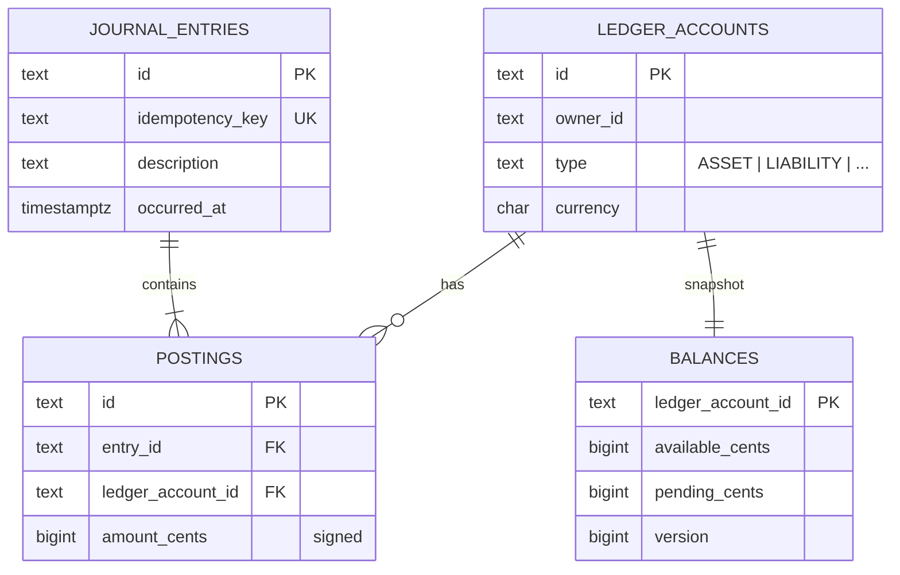

# Database Guidelines

## Database per Service

Each service owns a dedicated **PostgreSQL** database (or schema in local development). Cross-service data access happens **only** through APIs or events, never through direct queries or shared tables.

| Service | Database | Main tables |
|---|---|---|
| identity-service | `identity` | `credentials`, `sessions`, `refresh_tokens`, `devices`, `mfa_factors` |
| user-service | `users` | `users`, `addresses`, `kyc_verifications` |
| account-service | `accounts` | `accounts`, `account_limits` |
| ledger-service | `ledger` | `ledger_accounts`, `journal_entries`, `postings`, `balances` |
| transaction-service | `transactions` | `transactions`, `saga_steps` |
| pix-service | `pix` | `pix_keys`, `pix_transfers`, `qr_codes` |
| payment-service | `payments` | `boleto_payments`, `scheduled_payments` |
| card-service | `cards`, `card_vault` | `cards`, `authorizations` / `vault_entries` |
| credit-service | `credit` | `credit_lines`, `invoices`, `invoice_items`, `installments` |
| statement-service | `statements` | `feed_items`, `monthly_statements` |
| notification-service | `notifications` | `notifications`, `preferences`, `templates` |

Every service that publishes or consumes events also has `outbox` and `inbox` tables.

## Read / Write Separation

Each service connects to **two** database endpoints ([ADR-0009](../decisions/0009-read-write-separation.md)):

| Variable | Target | Used by |
|---|---|---|
| `DB_WRITE_URL` | Primary (via PgBouncer) | `CommandRepository`: inserts, updates, `SELECT ... FOR UPDATE`, reads that decide money movements |
| `DB_READ_URL` | Read replicas (via PgBouncer, load-balanced) | `QueryRepository`: screens, lists, history |

```text
            writes                         async streaming
  service ─────────▶ [ primary ] ───────────────────────▶ [ replica 1..N ]
     │                    │ sync                                ▲
     │                    ▼                                     │
     │              [ standby (other AZ) ]                      │
     └──────────────────────── reads ───────────────────────────┘
```

- In local development, both variables can point to the same database.
- Replica lag is monitored, and replicas lagging more than 500 ms are removed from the read pool.
- See [scalability.md](../architecture/scalability.md#read--write-separation) for read-your-writes handling.

## Sharding

High-volume services (ledger, transactions, Pix, cards, statements) are sharded by `customer_id` into **4,096 logical shards** mapped to physical clusters ([ADR-0010](../decisions/0010-sharding-and-cells.md)). Every table in a sharded service includes the `customer_id` (or a key derived from it) so each query is routed to exactly one shard.

## Partitioned Tables

Append-only, high-volume tables use PostgreSQL declarative partitioning:

```sql
CREATE TABLE postings (
    id                 TEXT        NOT NULL,
    entry_id           TEXT        NOT NULL,
    ledger_account_id  TEXT        NOT NULL,
    amount_cents       BIGINT      NOT NULL,
    currency           CHAR(3)     NOT NULL,
    created_at         TIMESTAMPTZ NOT NULL,
    PRIMARY KEY (id, created_at)
) PARTITION BY RANGE (created_at);

CREATE TABLE postings_2026_11 PARTITION OF postings
    FOR VALUES FROM ('2026-11-01') TO ('2026-12-01');
```

Partitions are created ahead of time by a scheduled job (`pg_partman`) and old partitions are moved to cold storage.

## Connection Pooling

- **PgBouncer** in transaction mode in front of every primary and replica.
- `pgxpool` per pod with explicit `MaxConns`. Total = `pods × MaxConns` must stay below the PgBouncer pool.
- Every query has `statement_timeout`. Every transaction has `lock_timeout` and `idle_in_transaction_session_timeout`.

## Indexing Rules

- Every query on a hot path must use an index. CI runs `EXPLAIN` checks on critical queries.
- Prefer composite indexes that match the access pattern, for example `(account_id, created_at DESC)` for the feed.
- Use keyset (cursor) pagination. `OFFSET` is forbidden on large tables.
- Create indexes with `CREATE INDEX CONCURRENTLY` in migrations.

## Conventions

- Table names: `snake_case`, plural.
- Primary keys: `id` as ULID stored in `TEXT`/`UUID`, generated by the application.
- Timestamps: `TIMESTAMPTZ` in UTC (`created_at`, `updated_at`).
- Concurrency: `version BIGINT` column for optimistic locking on mutable aggregates.
- Soft deletes only when required by the business. Financial records are never deleted.

## Money

```sql
amount_cents  BIGINT      NOT NULL,
currency      CHAR(3)     NOT NULL DEFAULT 'BRL'
```

- **Never** use `FLOAT`, `REAL` or `DOUBLE`.
- Interest calculations use `NUMERIC` internally and round explicitly (banker's rounding) before persisting cents.

## Ledger Model



Invariants (enforced in the domain **and** checked in the database):

- `SUM(postings.amount_cents) = 0` for each `journal_entry`.
- `journal_entries` and `postings` are append-only (`UPDATE`/`DELETE` revoked at the role level).
- Customer checking balances cannot become negative unless an overdraft limit exists.

## Outbox Table

```sql
CREATE TABLE outbox (
    id            TEXT PRIMARY KEY,
    aggregate_id  TEXT        NOT NULL,
    topic         TEXT        NOT NULL,
    payload       JSONB       NOT NULL,
    headers       JSONB       NOT NULL DEFAULT '{}',
    created_at    TIMESTAMPTZ NOT NULL DEFAULT now(),
    published_at  TIMESTAMPTZ
);
CREATE INDEX idx_outbox_unpublished ON outbox (created_at) WHERE published_at IS NULL;
```

## Migrations

- Tool: [`golang-migrate`](https://github.com/golang-migrate/migrate) (or `goose`).
- Location: `services/<name>/migrations/`.
- File naming: `000001_create_accounts.up.sql` / `000001_create_accounts.down.sql`.
- Migrations must be **backward compatible** with the previously deployed version (expand → migrate → contract).

## Local Development

Initialization scripts and seed data live in `infrastructure/databases/`.
