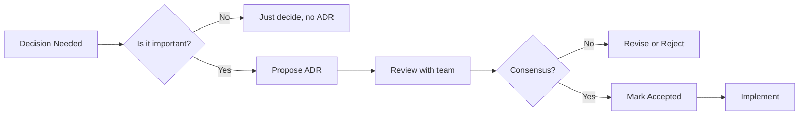

# Architecture Decision Records (ADRs)

This directory contains Architecture Decision Records (ADRs) documenting significant architectural decisions made during the development of the Digital Bank Platform.

## Overview

ADRs capture the context, decision, and consequences of architectural choices. They provide a historical record and rationale for future reference.

## Format

Each ADR follows this structure:

```markdown
# [Title]

## Status

- [ ] proposed
- [x] accepted
- [ ] rejected
- [ ] superseded

## Context

Why are we making this decision? What problem are we solving?

## Decision

What is our decision? Be specific.

## Consequences

What does this decision imply? List technical, operational, and business consequences.

## References

Links to relevant documents, code, or external resources.

## Related ADRs

Links to related or dependent ADRs.
```

## Decision Status

| Status | Meaning |
|--------|---------|
| `proposed` | Decision is under discussion |
| `accepted` | Decision is agreed upon by team |
| `rejected` | Proposal was considered but rejected |
| `superseded` | Decision replaced by a later ADR |

## ADR Index

| # | Title | Date | Status | Summary |
|---|-------|------|--------|---------|
| [001](./001-template.md) | ADR Template | TBD | proposed | Standard ADR template and guidelines |
| [002](./002-use-go.md) | Use Go | TBD | proposed | Select Go 1.23+ as the primary language |
| [003](./003-ddd.md) | Domain-Driven Design | TBD | proposed | Apply DDD to structure services |
| [004](./004-hexagonal.md) | Hexagonal Architecture | TBD | proposed | Service structure with dependency inversion |
| [005](./005-events.md) | Event-Driven Architecture | TBD | proposed | Kafka-based eventing |
| [006](./006-gateway.md) | API Gateway Strategy | TBD | proposed | Single entry point for external APIs |
| [007](./007-gprc.md) | gRPC Internal Communication | TBD | proposed | Protocol Buffers for service-to-service |
| [008](./008-dbs-per-svc.md) | Database Per Service | TBD | proposed | One database per service, no cross-service access |
| [009](./009-outbox.md) | Transactional Outbox Pattern | TBD | proposed | Reliable event publishing |
| [010](./010-sagas.md) | Orchestrated Sagas | TBD | proposed | Distributed transactions management |
| [011](./011-read-replicas.md) | Read-Write Separation | TBD | proposed | CQRS with read replicas |
| [012](./012-cache.md) | Caching Strategy | TBD | proposed | Redis for sessions and reference data |
| [013](./013-observability.md) | Observability Strategy | TBD | proposed | OpenTelemetry stack |
| [014](./014-security.md) | Zero-Trust Security | TBD | proposed | mTLS between services |
| [015](./015-encryption.md) | Encryption at Rest | TBD | proposed | Sensitive data encryption |
| [016](./016-mtls.md) | Mutual TLS Authentication | TBD | proposed | Service mesh security |
| [017](./017-cicd.md) | CI/CD Pipeline | TBD | proposed | GitHub Actions for CI/CD |
| [018](./018-double-entry.md) | Double-Entry Ledger | TBD | accepted | Ledger design for balance management |
| [019](./019-sharding.md) | Data Sharding | TBD | proposed | Customer-based sharding |
| [020](./020-autoscaling.md) | Stateless Autoscaling | TBD | proposed | Kubernetes HPA for scale |

## How to Create an ADR

1. Create a new file: `YYYY-NN-title.md` (e.g., `2024-01-ledger.md`)
2. Use the standard template
3. Reference related ADRs
4. Update the index table
5. Get team consensus before marking `accepted`

## How to Write an ADR

### Context

Describe:
- The problem or opportunity
- Constraints and requirements
- Alternatives considered
- Stakeholders affected

### Decision

State:
- What we're deciding
- Why this decision over alternatives
- Technical implementation approach

### Consequences

Document:
- Pros and cons of the decision
- Short-term and long-term impacts
- Reversibility if applicable
- Dependencies on other ADRs

## Guidelines

1. **Write early**: Document decisions as they emerge, even if provisional
2. **Be specific**: Avoid vague statements
3. **Link decisions**: Reference related ADRs
4. **Keep living**: Update as context changes
5. **Supersede, don't delete**: Mark old ADRs as `superseded`

## Workflow



## ADR Management

- New ADRs are reviewed by the architecture team
- Major ADRs require team consensus
- Rejected ADRs are documented for learning
- Superseded ADRs are referenced from new ADRs

## Related Documentation

- [Architecture Overview](../architecture/overview.md)
- [Services Documentation](../services/)
- [Main README](../README.md)
