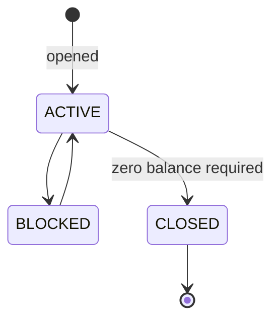

# account-service

## Responsibility

The lifecycle of customer checking accounts. It does **not** store balances: those belong to `ledger-service`.

## Capabilities

- Open an account after KYC approval (branch + account number)
- Block, unblock and close accounts
- Transaction limits (daily, per transaction, night time) configurable by the customer
- Balance queries (delegated to `ledger-service`)

## Account State Machine

## gRPC API

| Method | Description |
|---|---|
| `OpenAccount` | Create an account and its ledger account |
| `GetAccount` | Account details |
| `GetBalance` | Proxy to the ledger balance |
| `BlockAccount` / `UnblockAccount` | Change status |
| `CloseAccount` | Close the account |
| `UpdateLimits` | Change transaction limits |
| `CheckLimit` | Validate an amount against current limits |

## Events

| Publishes | Consumes |
|---|---|
| `account.opened` | `user.kyc.approved` (open account) |
| `account.blocked` | |
| `account.unblocked` | |
| `account.closed` | |
| `account.limits.changed` | |

## Dependencies

- `ledger-service` (gRPC): creates ledger accounts and reads balances

## Data

`accounts`, `account_limits`, `outbox`, `inbox`.
