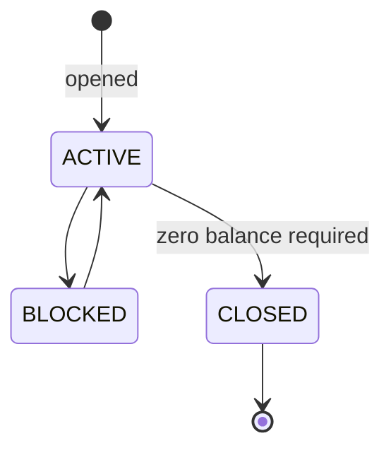

# account-service

## Responsibility

The lifecycle of customer checking accounts. It does **not** store balances: those belong to `ledger-service`.

## Capabilities

- Open an account only after KYC approval (user-service `GetIdentity`): the holder name and CPF are the verified ones; a different CPF in the request is refused (`DOCUMENT_MISMATCH`); branch + account number
- Block, unblock and close accounts
- Transaction limits (daily, per transaction, night time) configurable by the customer
- Balance queries (delegated to `ledger-service`)

## Account State Machine

## gRPC API

Defined in [`contracts/proto/bank/account/v1/account.proto`](../../contracts/proto/bank/account/v1/account.proto).

| Method | Description |
|---|---|
| `OpenAccount` | Create the ledger account, then the account (idempotent on `idempotency_key`) |
| `GetAccount` / `ListAccounts` | Account details, accounts of a customer |
| `GetBalance` | Proxy to the ledger balance |
| `BlockAccount` / `UnblockAccount` | Change status |
| `CloseAccount` | Close the account (zero balance, nothing held) |
| `GetBalanceAt` | The posted balance at an instant (from the ledger; the annual income report) |
| `GetLimits` / `UpdateLimits` | Limits and current usage |
| `ConsumeLimit` | Check **and record** an outgoing amount atomically (idempotent on `transaction_id`) |
| `RestoreLimit` | Give the usage back (saga compensation) |

## Limits

- Per transaction, daily (resets at local midnight, `America/Sao_Paulo`) and nightly (20:00–06:00, a window that crosses midnight).
- Defaults: R$ 5.000 per transaction, R$ 20.000 per day, R$ 1.000 per night. The daily limit is capped at R$ 100.000 without manual review.
- `ConsumeLimit` locks the account row, sums the usage and inserts a usage row in one transaction, so concurrent transfers cannot jointly exceed a limit. A separate read-only check would allow that race.

## Opening Flow

1. The account ID is derived from the idempotency key (UUIDv5), so retries target the same ledger account.
2. `ledger.CreateLedgerAccount` (idempotent on ID).
3. Insert the account, its default limits and `account.opened` in the outbox, in one transaction.

If step 3 fails, retrying with the same key completes it. An orphan ledger account would only ever hold a zero balance.

## Events

| Publishes | Consumes |
|---|---|
| `account.opened` | — (asks user-service synchronously when opening) |
| `account.blocked` | |
| `account.unblocked` | |
| `account.closed` | pix-service removes the keys, card-service cancels the cards, notification-service tells the customer |
| `account.limits.changed` | |

## Dependencies

- `ledger-service` (gRPC): creates ledger accounts and reads balances

## Data

`accounts`, `account_limits`, `outbox`, `inbox`.
