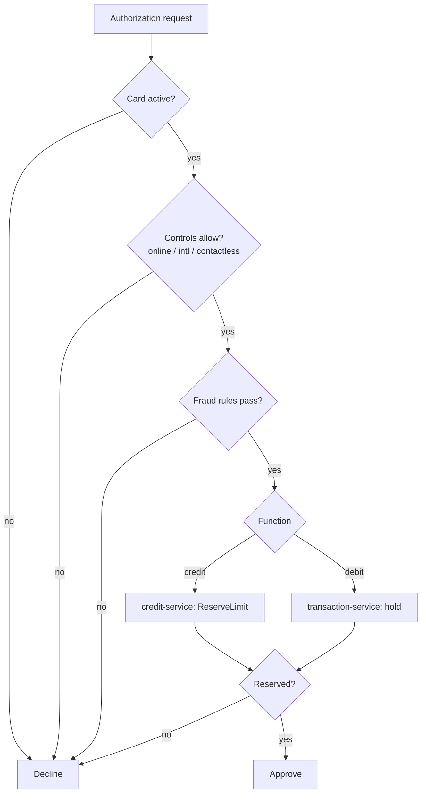

# card-service

## Responsibility

Debit and credit cards: issuing, controls and real-time **purchase authorization**. The card network is **simulated**.

## Capabilities

- Issue physical and virtual cards (multiple virtual cards per customer)
- Temporary virtual cards for one-off online purchases
- Block / unblock, report lost or stolen, reissue
- Controls: online purchases, international purchases, contactless
- Show card details (requires step-up authentication)
- Real-time authorization (debit and credit) with a **< 200 ms p99** target
- Clearing and settlement of authorized purchases

## Card Vault

The PAN and CVV are stored in an isolated **vault** module with its own database, encryption keys and network policy. The rest of the platform only sees a `card_token` and `last4`. See [security](../architecture/security.md#card-data-pci-dss-inspired).

## Authorization Flow

## gRPC API

| Method | Description |
|---|---|
| `IssueCard` | Issue a physical or virtual card |
| `ListCards` / `GetCard` | Query cards |
| `BlockCard` / `UnblockCard` | Change status |
| `UpdateControls` | Toggle online, international and contactless |
| `RevealCardDetails` | Return the PAN and CVV (step-up required) |
| `Authorize` | Authorization request from the network simulator |
| `Clear` | Clearing of an authorized purchase |

## Events

| Publishes | Consumes |
|---|---|
| `card.issued` | `account.blocked` / `account.closed` (block cards) |
| `card.blocked` | `credit.invoice.overdue` (block credit function) |
| `card.authorization.approved` | `credit.limit.changed` |
| `card.authorization.declined` | |
| `card.purchase.cleared` | |

## Data

- `cards`: `authorizations`, `card_controls`, `outbox`, `inbox`
- `card_vault`: `vault_entries` (encrypted PAN, expiry)
