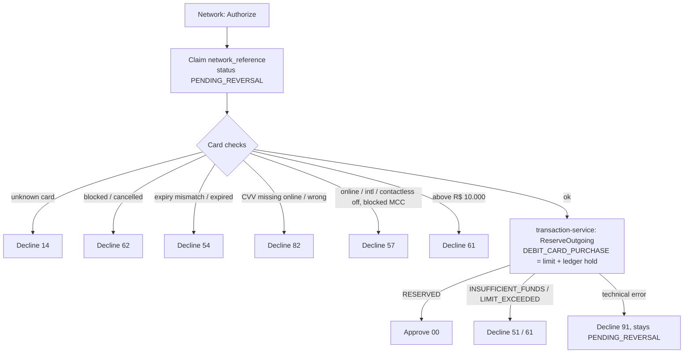

# card-service

## Responsibility

Debit cards: issuing, controls and real-time **purchase authorization**, then clearing and reversal. The card network is **simulated** (sandbox endpoints on the gateway play the network).

## Capabilities

| Capability | Status |
|---|---|
| Issue physical (5 years) and virtual (1 year) debit cards for active accounts, idempotent | ✅ |
| Block / unblock; cards follow the account (blocked account → cards blocked, closed → cancelled) | ✅ |
| Controls: online, international (off by default), contactless | ✅ |
| Reveal card number, expiry and CVV to the holder (`Cache-Control: no-store`) | ✅ (step-up MFA planned) |
| Real-time authorization with ISO 8583-style response codes | ✅ |
| Clearing (full or partial) and merchant reversal | ✅ |
| Credit function (needs credit-service), tokenization for wallets, 3-D Secure | planned |

## Card Vault

- The card number (PAN) exists only in `card_vault`, **encrypted** with AES-256-GCM bound to the card id, plus an HMAC **blind index** so an authorization can find the card by PAN without decrypting anything.
- The **CVV is never stored**: it is derived as `HMAC(CVK, PAN | expiry)`, the way an issuer's HSM computes it with its card verification key. It cannot be recomputed without the key.
- PAN key, index key and CVK are derived from one master key (`CARD_VAULT_KEK`). Production would put them in an HSM and move the vault to its own service and database (PCI DSS scope reduction).
- Card numbers are 16 digits with a valid Luhn check digit under BIN `999999` (not assigned to a real issuer). Events and other services only ever see the card id and `last4`.

## Authorization Flow

- **Idempotent on `network_reference`**: a network retry gets the same answer and never reserves twice.
- **Crash-safe**: the authorization is stored as `PENDING_REVERSAL` *before* any money is touched. If the reservation outcome is unknown (timeout, crash), the network gets `91` and a worker replays the reservation (idempotent: it returns what exists) and releases it. A declined purchase never leaves money held.
- **Clearing** captures the hold for the authorized amount or less (`CompleteTransaction` with an amount). **Reversal** releases it. Card reservations live up to 7 days (`CARD_AUTHORIZATION_TIMEOUT`) instead of a Pix's 15 minutes.
- Purchases appear in the statement as `DEBIT_CARD_PURCHASE` with the merchant's name.

Measured locally (docker compose, 54 authorizations): p50 2.6 ms, p99 9 ms, against a target of p99 < 200 ms (`card_authorization_seconds`).

## gRPC API

Defined in [`contracts/proto/bank/card/v1/card.proto`](../../contracts/proto/bank/card/v1/card.proto).

| Method | Description |
|---|---|
| `IssueCard` / `GetCard` / `ListCards` | Issue and query |
| `BlockCard` / `UnblockCard` / `UpdateControls` | Customer controls |
| `RevealCardDetails` | PAN, expiry, CVV |
| `Authorize` / `Clear` / `Reverse` | Network-facing |

## Events

| Publishes (`bank.card.events`) | Consumes |
|---|---|
| `card.issued`, `card.blocked`, `card.unblocked`, `card.controls.changed` | `account.blocked`, `account.unblocked`, `account.closed` |
| `card.authorization.approved`, `card.authorization.declined`, `card.authorization.reversed`, `card.purchase.cleared` | |

## Data

`cards`, `card_vault`, `authorizations`, `outbox`, `inbox`.
