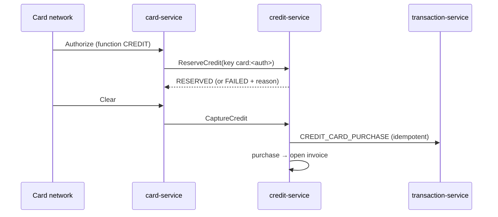
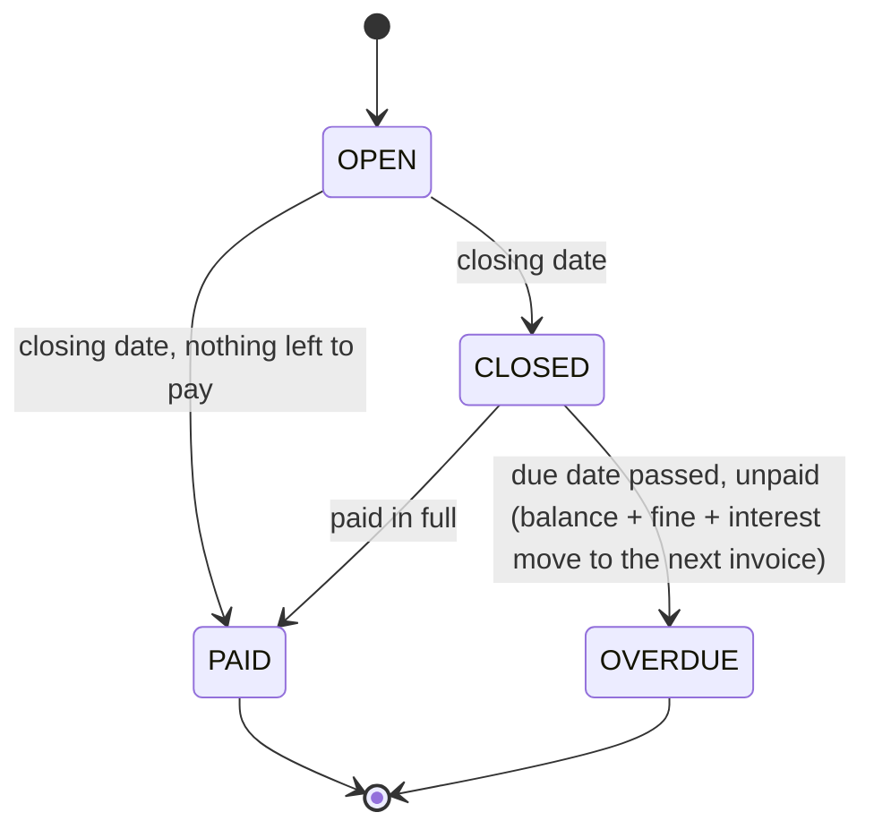

# credit-service

## Responsibility

Credit card credit: the **credit line** (limit), holds for card authorizations, monthly **invoices**, invoice payments from the checking account and the charges on unpaid balances.

## Capabilities

| Capability | Status |
|---|---|
| One credit line per active account (default limit R$ 1.000,00, `CREDIT_DEFAULT_LIMIT_CENTS`), closing day 1–28, due 10 days after closing | ✅ |
| Holds for card authorizations (`ReserveCredit` / `CaptureCredit` / `ReleaseCredit`), idempotent on the authorization key, same contract card-service uses for debit; refusals `INSUFFICIENT_LIMIT` (→ ISO `51`), `NO_CREDIT_LINE` (`57`), `CREDIT_LINE_BLOCKED` (`62`) | ✅ |
| Partial capture: only the captured amount stays on the limit and goes into the open invoice | ✅ |
| Holds never cleared expire after 7 days | ✅ |
| Invoice cycle on São Paulo dates: OPEN → CLOSED (or PAID if nothing to pay) at the closing date, the next invoice opens | ✅ |
| Payments of an open (in advance) or closed invoice, total or partial, from the checking account; payments in flight count against what is left, so concurrent payments can never overpay | ✅ |
| Past the due date the unpaid balance moves to the next invoice with a 2% fine and a month of interest (8% a month by default); the overdue invoice is no longer payable | ✅ |
| Sandbox: close the open invoice now / make the closed one overdue (`AdvanceCycle`) | ✅ |
| Card refunds (`RefundCredit`, idempotent on the key): card clearing → credit-receivables in the ledger (`CREDIT_CARD_REFUND`), a `REFUND` credit on the open invoice and the limit freed; a credit larger than the invoice moves to the next one when it closes (`CREDIT_CARRIED_OUT` / `CREDIT_CARRIED_IN`) | ✅ |
| Interest-free installment purchases (`parcelado sem juros`, 2 to 12, at least R$ 5,00 each): the whole amount is held on the limit and posted to the ledger at capture; the first installment (with the remainder centavo) goes on the invoice the purchase is captured on, and each new invoice takes the next installment of every plan (robust to early closings); `upcoming_installments` on the line, `ListInstallmentPlans` | ✅ |
| Minimum payment on every invoice: 15% of the balance, at least R$ 50 (or all of it); what is not paid by the due date rolls over with the fine and revolving interest | ✅ |
| Invoice plans (`parcelamento da fatura`): a closed invoice of at least R$ 100 split into 2 to 12 fixed installments (Price table, 4.99% a month, below the revolving rate), quoted with the total, the interest and the CET; the invoice is settled by the plan, the first installment goes on the open invoice and one more on each new invoice; the interest is added to the debt and booked as revenue in the ledger (retried until posted); idempotent | ✅ |
| Limit changes (whole reais, up to R$ 20.000): a decrease applies at once (never below what is used); an increase is analyzed at once: refused with an overdue invoice, a blocked line or a score under 250 (`LOW_SCORE`), granted up to what the score allows (+50% from 450, +100% from 750; under 450 nothing automatic), otherwise in review for an analyst who may grant less or refuse with a reason (back office, audited, with the score at request time); one request in review per line; idempotent | ✅ |
| Behaviour score 0–1000 (`GetCreditScore`), explainable factor by factor from a base of 500: invoices paid on time in the last 12 months (+30 each, up to +240), late ones (−120 each), an invoice overdue now (−200), share of the limit used (≤30% +80, ≤60% +30, ≤90% −40, more −100), months of relationship (+5 each, up to +120), invoice plans in 12 months (−60 each); bands LOW / FAIR / GOOD / EXCELLENT | ✅ |
| Blocking the line with the account, a credit score from payment history | planned |

## Money in the Ledger

credit-service never holds money; it posts one-step movements through transaction-service between bank-internal ledger accounts:

| When | Type | From → To |
|---|---|---|
| A credit purchase clears | `CREDIT_CARD_PURCHASE` | `credit-receivables` → `card-clearing` |
| The customer pays an invoice | `CREDIT_INVOICE_PAYMENT` | customer account → `credit-receivables` |
| Fine and interest are charged | `CREDIT_CHARGES` | `credit-receivables` → `credit-revenue` |

So the balance of `credit-receivables` is always minus what customers owe (`used` of every line without the open holds). The application tests check this after every step of a full cycle.

## Invoice Lifecycle

## Consistency

- Every change runs in one database transaction with row locks taken line first, then invoice (no deadlocks).
- Network calls happen outside transactions, with idempotency keys derived from ids (`credit-capture:<hold>`, `credit-payment:<payment>`, `credit-charges:<invoice>`), so a retry never moves money twice.
- A payment is stored `PENDING` before the transfer; if the answer is lost, the worker settles it with the same key.
- Overdue charges are recorded first (`charges_posted = false`) and posted to the ledger afterwards by the worker, until it succeeds.

## gRPC API

Defined in [`contracts/proto/bank/credit/v1/credit.proto`](../../contracts/proto/bank/credit/v1/credit.proto). Callers: api-gateway, card-service.

| Method | Description |
|---|---|
| `OpenCreditLine` / `GetCreditLine` | Open (idempotent) and read the line |
| `ListInvoices` / `GetInvoice` | Invoices and their items |
| `PayInvoice` | Pay from the checking account |
| `ReserveCredit` / `CaptureCredit` / `ReleaseCredit` / `RefundCredit` | Used by card-service |
| `AdvanceCycle` | Sandbox only |

## Events

| Publishes (`bank.credit.events`) | Consumes |
|---|---|
| `credit.line.opened`, `credit.purchase.captured`, `credit.invoice.closed`, `credit.invoice.overdue`, `credit.invoice.payment.completed`, `credit.invoice.payment.failed` | — |

## Background Jobs

One worker (`CYCLE_INTERVAL`, 30 s by default): closes due invoices, makes unpaid ones overdue, posts pending charges, releases expired holds and settles stuck payments.

## Dependencies

- `account-service` (the account must be active to open a line)
- `transaction-service` (all money movements)

## Data

`credit_lines`, `invoices`, `invoice_items`, `holds`, `payments`, `outbox`, `inbox`.
