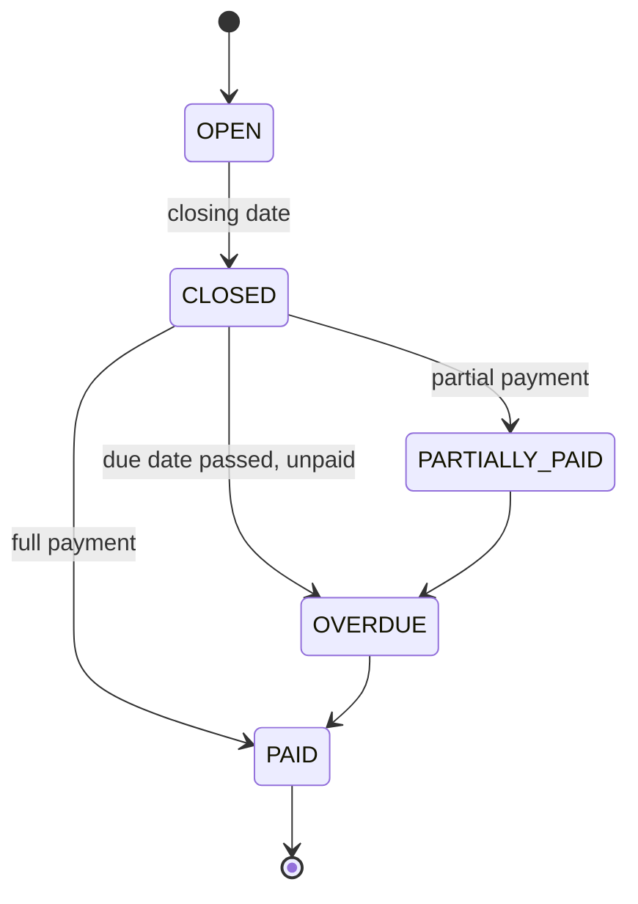

# credit-service

## Responsibility

Credit card credit: limits, monthly **invoices**, installments and interest.

## Capabilities

- Credit line with total, used and available limit
- Limit reservation for card authorizations (and release on cancellation)
- Purchases in installments (`parcelado`): future installments are reserved against the limit
- Monthly invoice cycle: open → closed → paid / overdue
- Configurable due date
- Partial payment and minimum payment, with revolving interest (rotativo)
- Invoice payment from the checking account
- Late fees and interest (calculated with `NUMERIC`, rounded to cents)

## Invoice Lifecycle

## gRPC API

| Method | Description |
|---|---|
| `GetCreditLine` | Limits |
| `ReserveLimit` / `ReleaseLimit` | Used by `card-service` during authorization |
| `ListInvoices` / `GetInvoice` | Invoices and items |
| `PayInvoice` | Pay from the checking account |
| `SimulateInstallments` | Simulate an installment plan |
| `ChangeDueDate` | Change the billing cycle |

## Events

| Publishes | Consumes |
|---|---|
| `credit.limit.changed` | `card.authorization.approved` (add to invoice) |
| `credit.invoice.closed` | `card.purchase.cleared` |
| `credit.invoice.paid` | `account.closed` |
| `credit.invoice.overdue` | |

## Background Jobs

- **Invoice closer**: closes invoices on their closing date and opens the next cycle.
- **Overdue checker**: flags overdue invoices and applies interest and fees.

## Dependencies

- `transaction-service` (invoice payment)

## Data

`credit_lines`, `invoices`, `invoice_items`, `installments`, `limit_reservations`, `outbox`, `inbox`.
