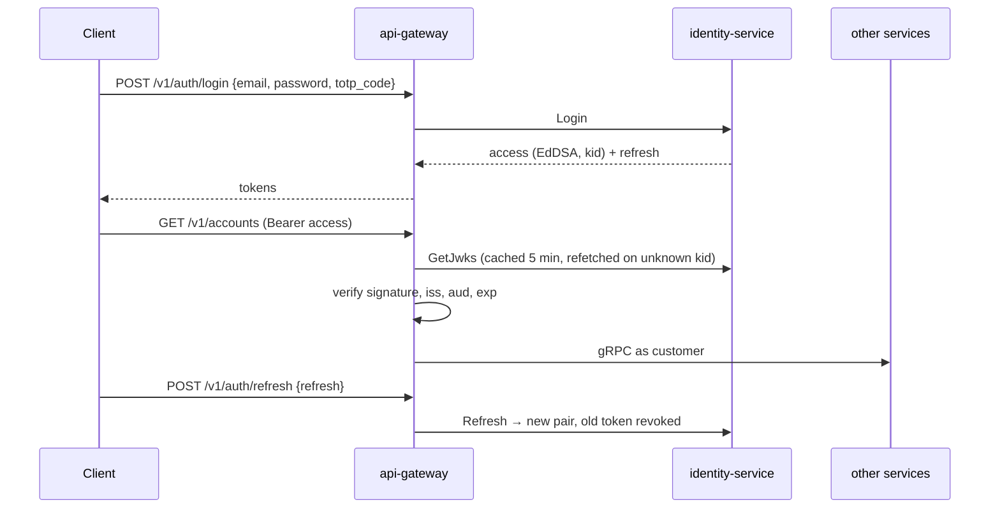

# identity-service

## Responsibility

Who the customer is. It owns credentials and sessions, issues access tokens, and publishes the public keys that let everyone else verify them. No other service holds a signing secret.

## Capabilities

| Capability | Status |
|---|---|
| Sign-up with email + password (argon2id, m=19 MiB, t=2, p=1; 10–128 characters, no composition rules) | ✅ |
| Login with lockout (5 failures → 15 min) and the same cost for unknown emails (dummy hash), so timing does not reveal accounts | ✅ |
| TOTP MFA (RFC 6238, SHA-1, 6 digits, ±1 step), enroll → confirm, replay protection (`totp_last_step`) | ✅ |
| Ed25519 (EdDSA) access tokens, 15 min, `kid` header, issuer `digital-bank-identity`, audience `digital-bank-api` | ✅ |
| Rotating refresh tokens (30 days, stored as SHA-256), reuse detection revoking the whole family, logout | ✅ |
| JWKS (`GetJwks`) and key rotation (`RotateSigningKey`, automatic after 30 days); retired keys stay published for 20 min | ✅ |
| Signing keys and TOTP seeds encrypted at rest (AES-256-GCM under `IDENTITY_KEK`, bound to their row) | ✅ |
| Step-up tokens (`StepUp`): password (+ TOTP when enabled) re-checked with lockout; 5-minute token, audience `digital-bank-step-up`, `amr` claim, required by the gateway for sensitive actions | ✅ |
| Roles: `CUSTOMER` and `ANALYST` (back office) in the access token's `role` claim, kept across refreshes; a development analyst is bootstrapped from `BOOTSTRAP_ANALYST_EMAIL` / `BOOTSTRAP_ANALYST_PASSWORD` | ✅ |
| Password reset, device binding, session listing, staff from the bank's SSO with mandatory MFA | planned |

## Token Flow

## Refresh Token Reuse Detection

Each login starts a **family**. Refreshing revokes the presented token and issues the next one in the same family. If a revoked token is ever presented again, someone has a copy (the legitimate client already moved on, or an attacker did): the whole family is revoked and both must log in again.

## Why These Choices

- **Asymmetric tokens.** The gateway (and any future verifier) only needs public keys. A compromised gateway cannot mint tokens.
- **Opaque, hashed refresh tokens.** Long-lived credentials are revocable and useless if the table leaks.
- **Encryption with associated data.** Secrets are encrypted with `aad = "totp:<customer>"` / `"signing-key:<kid>"`, so a ciphertext moved to another row does not decrypt.
- **The KEK comes from the environment** in this repository; in production it comes from a KMS, and can be rotated thanks to the version byte in every ciphertext ([ADR-0015](../decisions/0015-encryption.md)).

## gRPC API

Defined in [`contracts/proto/bank/identity/v1/identity.proto`](../../contracts/proto/bank/identity/v1/identity.proto). `RotateSigningKey` is for operators and is not exposed by the gateway.

| Method | Errors (reason) |
|---|---|
| `Register` | `INVALID_ARGUMENT`, `EMAIL_TAKEN` |
| `Login` | `INVALID_CREDENTIALS`, `MFA_REQUIRED`, `INVALID_MFA_CODE`, `ACCOUNT_LOCKED` |
| `Refresh` | `INVALID_REFRESH_TOKEN`, `REFRESH_TOKEN_REUSED` |
| `Logout` | — (unknown tokens are ignored) |
| `EnrollTotp` / `ConfirmTotp` | `TOTP_ALREADY_ENABLED`, `INVALID_MFA_CODE` |
| `GetJwks`, `RotateSigningKey` | — |

## Events

| Publishes (`bank.identity.events`) | Consumes |
|---|---|
| `identity.customer.registered` (customer id only, no PII) | — |

## Data

`credentials`, `refresh_tokens`, `signing_keys`, `outbox`.
