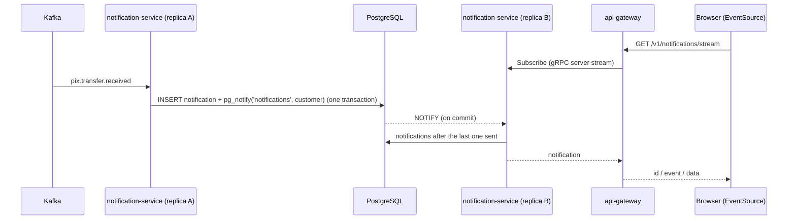

# notification-service

## Responsibility

Tells customers what happened to their money: turns the other services' events into notifications, keeps an in-app inbox, delivers pushes and e-mails according to preferences, and streams new notifications live.

## Capabilities

| Capability | Status |
|---|---|
| Notifications from events: Pix received / sent / failed, transfers received, card purchases approved / declined (debit or credit), invoice closed / overdue / payment received, boleto paid / scheduled / not paid, account blocked / unblocked (texts in Portuguese, amounts as `R$ 1.234,56`) | ✅ |
| Exactly once per event (inbox + `UNIQUE (event_id, account_id)`), even when Kafka redelivers | ✅ |
| Account → customer from `account.opened` events, or asked to account-service when another topic's event arrives first | ✅ |
| Inbox: list (newest first, unread filter, cursor), unread count, mark some or all read | ✅ |
| Preferences: push (default on) and e-mail (default off, important notifications only: failures, bills, security) | ✅ |
| Push / e-mail sent after the commit by a dispatcher, retried up to 5 times (providers simulated by logging) | ✅ |
| Live stream (Server-Sent Events through the gateway): new notifications in milliseconds, across replicas, with `Last-Event-ID` replay after a reconnection | ✅ |
| A new deployment only notifies recent events (the consumer group starts 10 minutes back; events older than 24 h are never announced) | ✅ |
| Real push (APNs / FCM) and e-mail providers, device registration, quiet hours | planned |

## Live Stream Across Replicas

Whichever replica consumes the event, the one holding the client's stream is woken by `LISTEN / NOTIFY` and reads what is new (measured: ~6 ms in the test across two instances). Streams also re-read every 15 s, so a lost NOTIFY only delays a notification. The gateway sends a ping comment every 15 s, lifts the server write timeout for the stream and ends it after 10 minutes so the client reconnects with a fresh token, resuming from `Last-Event-ID`.

## gRPC API

Defined in [`contracts/proto/bank/notification/v1/notification.proto`](../../contracts/proto/bank/notification/v1/notification.proto). Callers: api-gateway.

| Method | Description |
|---|---|
| `ListNotifications` / `MarkRead` | Inbox |
| `GetPreferences` / `UpdatePreferences` | Channels |
| `Subscribe` | Server stream of new notifications |

## Events

| Publishes | Consumes |
|---|---|
| — | `bank.account.events`, `bank.transaction.events`, `bank.pix.events`, `bank.card.events`, `bank.credit.events`, `bank.payment.events` |

## Dependencies

- `account-service` (owner of an account not yet seen)
- Kafka

## Data

`notifications`, `deliveries`, `preferences`, `account_owners`, `inbox`.
