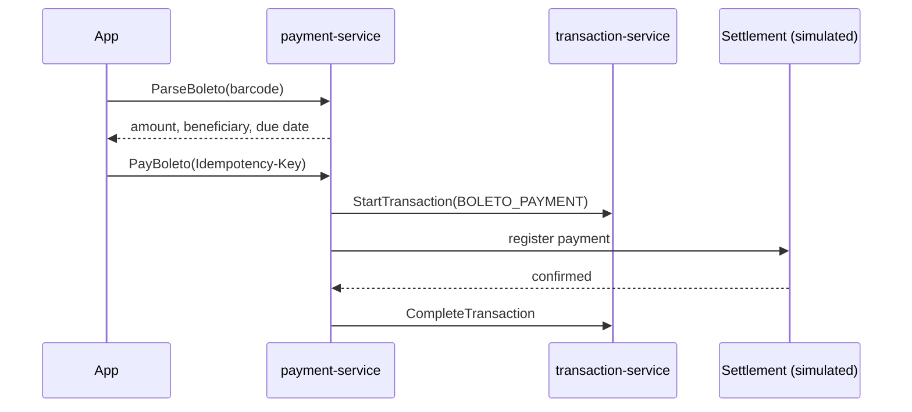

# payment-service

## Responsibility

Non-Pix payments: **boletos** (bank payment slips), scheduled and recurring payments, and bank transfers (TED).

## Capabilities

- Parse and validate a boleto barcode or typeable line (bank, amount, due date, check digits)
- Calculate fees and interest for late boletos
- Pay a boleto now or schedule it for a future date
- Recurring payments (monthly)
- Payment receipts

## Boleto Payment Flow

## gRPC API

| Method | Description |
|---|---|
| `ParseBoleto` | Decode and validate a barcode |
| `PayBoleto` | Pay immediately |
| `SchedulePayment` | Schedule for a date |
| `CancelScheduledPayment` | Cancel a scheduled payment |
| `ListPayments` | Payment history |
| `GetReceipt` | Payment receipt |

## Events

| Publishes | Consumes |
|---|---|
| `payment.boleto.paid` | `account.closed` (cancel schedules) |
| `payment.boleto.failed` | |
| `payment.scheduled.created` | |
| `payment.scheduled.executed` | |

## Background Jobs

- **Scheduler**: runs due scheduled payments every business day at 06:00 (with distributed locking).

## Data

`boleto_payments`, `scheduled_payments`, `receipts`, `outbox`, `inbox`.
