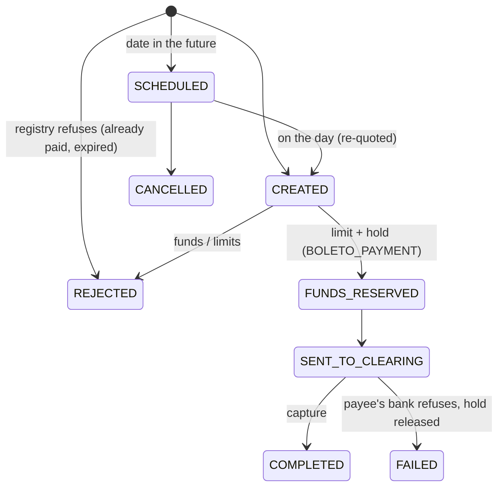

# payment-service

## Responsibility

Bill payments: **boletos**, paid now or scheduled, through a two-phase saga against a simulated registry (CIP) and clearing network.

## Capabilities

| Capability | Status |
|---|---|
| Parse a linha digitável (47 digits, with or without punctuation) or a barcode (44): field check digits (modulo 10), general check digit (modulo 11), bank, amount, due date factor (including the February 2025 factor restart) | ✅ |
| Lookup before paying: payee from the registry, nominal amount, and charges when overdue (2% fine + 1% a month pro rata); due dates on weekends move to Monday; refused 59 days after the due date | ✅ |
| Pay now: hold the money (limits apply), settle with the clearing network, then capture or release | ✅ |
| Boletos without an amount (the payer informs it) | ✅ |
| Schedule a payment up to the due date (re-quoted on the day), cancel while scheduled | ✅ |
| A boleto is paid once: a partial unique index forbids two live payments of the same barcode | ✅ |
| Crash safety: every state is stored before the next call; a worker resumes stuck payments with the same idempotency keys | ✅ |
| Sandbox: issue valid boletos (normal, already paid, refused by the payee's bank) | ✅ |
| Utility and tax bills (arrecadação, 48 digits), bank holidays, partial payments, DDA | planned |

## Payment States

The money goes from the customer to the ledger's internal `boleto-settlement` account (`BOLETO_PAYMENT`, two-phase like Pix out; transaction-service releases a reservation stuck for 15 minutes).

## Simulated Network

| Free field starts with | Behavior |
|---|---|
| `00000` | The registry says the boleto was already paid (`BOLETO_ALREADY_PAID`) |
| `99999` | The payee's bank refuses the settlement (`SETTLEMENT_REJECTED`); the hold is released |
| anything else | Settles |

Sandbox boletos (`POST /v1/sandbox/boletos`) are registered with their payee name, so lookups show it.

## gRPC API

Defined in [`contracts/proto/bank/payment/v1/payment.proto`](../../contracts/proto/bank/payment/v1/payment.proto). Callers: api-gateway.

| Method | Description |
|---|---|
| `LookupBoleto` | Parse, validate and quote |
| `PayBoleto` | Pay now or schedule (idempotent) |
| `GetBoletoPayment` / `ListBoletoPayments` | Query |
| `CancelBoletoPayment` | Cancel a scheduled payment |
| `IssueSandboxBoleto` | Sandbox only |

## Events

| Publishes (`bank.payment.events`) | Consumes |
|---|---|
| `boleto.payment.scheduled`, `boleto.payment.completed`, `boleto.payment.failed`, `boleto.payment.rejected`, `boleto.payment.cancelled` | — |

## Dependencies

- `transaction-service` (limits, hold, capture, release)

## Data

`boleto_payments`, `sandbox_boletos`, `outbox`, `inbox`.
