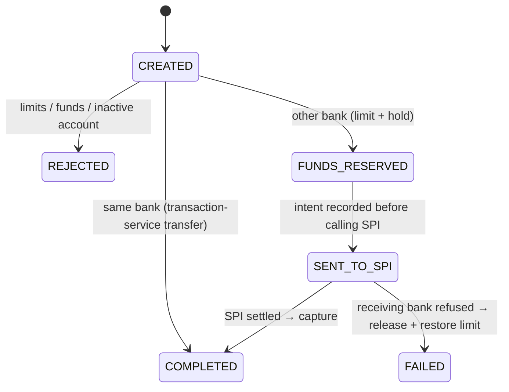

# pix-service

## Responsibility

Pix, the Brazilian instant payment system. Integrations with the Central Bank (**DICT** for keys, **SPI** for settlement) are **simulated** behind ports.

## Capabilities

| Capability | Status |
|---|---|
| Keys: register, list, delete (CPF, email, phone `+55DD9XXXXXXXX`, random EVP). Max 5 per account; a CPF key must be the holder's CPF | ✅ |
| Key lookup: receiver name, masked document (`***.982.247-**`), bank | ✅ |
| Transfer to a customer of this bank (one-step saga) | ✅ |
| Transfer to another bank: reserve → SPI → capture / release | ✅ |
| Incoming transfer from another bank (simulated SPI delivery) | ✅ |
| Keys removed when an account closes (`account.closed` consumer, inbox) | ✅ |
| QR codes (EMV BR Code), refunds, night-time Pix limits via `account-service` | planned |

## Outgoing Transfer Flow

- Every downstream call is idempotent: transaction keys are `pix:<transfer id>` (outgoing) and `pix-in:<E2E id>` (incoming), and SPI is idempotent on the E2E ID.
- A lease on the transfer row serializes processing; a recovery worker resumes transfers stuck in `CREATED`, `FUNDS_RESERVED` or `SENT_TO_SPI` (for example when transaction-service was down).
- `SENT_TO_SPI` is saved **before** calling SPI, so after a crash the worker asks SPI again (same E2E ID) instead of guessing.

## Simulators

The Central Bank systems are behind ports (`Directory`, `SPI`) with in-memory simulators:

| Key | Behaviour |
|---|---|
| `maria@outrobanco.com.br`, `+5511987654321` | Accounts at "Banco Exemplo" (ISPB 12345678); payments settle |
| `recusa@outrobanco.com.br` | The receiving bank rejects every payment (`RECEIVER_BANK_REJECTED`) |

`SimulateIncoming` plays the SPI delivering a Pix from another bank to one of our keys.

## gRPC API

Defined in [`contracts/proto/bank/pix/v1/pix.proto`](../../contracts/proto/bank/pix/v1/pix.proto).

| Method | Description |
|---|---|
| `RegisterKey` / `DeleteKey` / `ListKeys` | Key management |
| `LookupKey` | Resolve a key |
| `CreateTransfer` | Send a Pix (idempotent on `idempotency_key`) |
| `GetTransfer` | Transfer status |
| `SimulateIncoming` | Simulated SPI delivery |

## Events

| Publishes (`bank.pix.events`) | Consumes |
|---|---|
| `pix.key.registered`, `pix.key.deleted` | `account.closed` (remove keys) |
| `pix.transfer.completed`, `pix.transfer.failed`, `pix.transfer.received` | |

## Dependencies

- `account-service` (gRPC): holder name, document and status
- `transaction-service` (gRPC): transfers, reservations, credits

## Data

`pix_keys`, `pix_transfers`, `outbox`, `inbox`. Every transfer stores its `end_to_end_id` (E2E ID), the unique identifier of a Pix payment.
