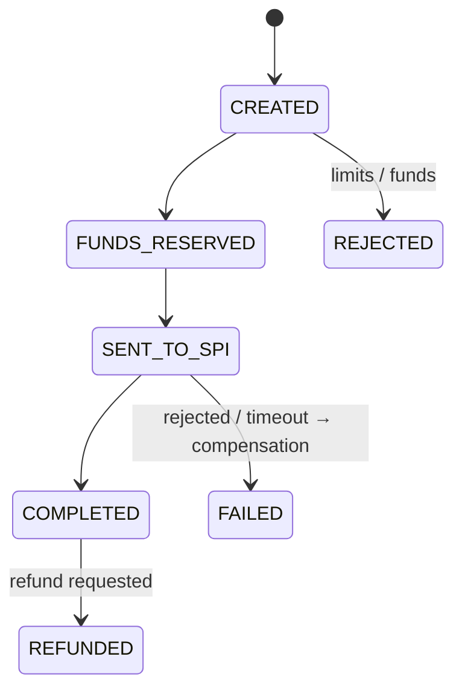

# pix-service

## Responsibility

Pix, the Brazilian instant payment system. Integrations with the Central Bank (**DICT** for keys, **SPI** for settlement) are **simulated** behind ports.

## Capabilities

- **Keys**: register, list and delete Pix keys (CPF, email, phone, random EVP). A customer can have at most 5 keys per account.
- **Key lookup**: resolve a key to the recipient's name, bank and masked document before confirming.
- **Transfers out**: send a Pix with a key, manual bank data or a QR code.
- **Transfers in**: receive Pix credits from the simulated SPI.
- **QR codes**: static (fixed key, optional amount) and dynamic (one-time charge with expiry), following the EMV BR Code format.
- **Refunds**: return a received Pix (full or partial).
- **Limits**: daytime and night-time limits enforced through `account-service`.

## Outgoing Transfer Flow

See [overview › Pix transfer](../architecture/overview.md#pix-transfer-outgoing).

## gRPC API

| Method | Description |
|---|---|
| `RegisterKey` / `DeleteKey` / `ListKeys` | Key management |
| `LookupKey` | Resolve a key |
| `CreateTransfer` | Send a Pix |
| `GetTransfer` | Transfer status |
| `CreateQrCode` / `DecodeQrCode` | QR code operations |
| `RefundTransfer` | Refund a received Pix |

## Events

| Publishes | Consumes |
|---|---|
| `pix.key.registered` | `account.opened` (enable Pix) |
| `pix.key.deleted` | `account.blocked`, `account.closed` (disable keys) |
| `pix.transfer.completed` | |
| `pix.transfer.failed` | |
| `pix.transfer.received` | |
| `pix.refund.completed` | |

## Dependencies

- `transaction-service` (gRPC)
- `account-service` (gRPC, limits)
- DICT / SPI simulators (ports `KeyDirectory`, `SettlementGateway`)

## Data

`pix_keys`, `pix_transfers`, `qr_codes`, `refunds`, `outbox`, `inbox`.

Every transfer stores its `end_to_end_id` (E2E ID), the unique identifier of the payment.
