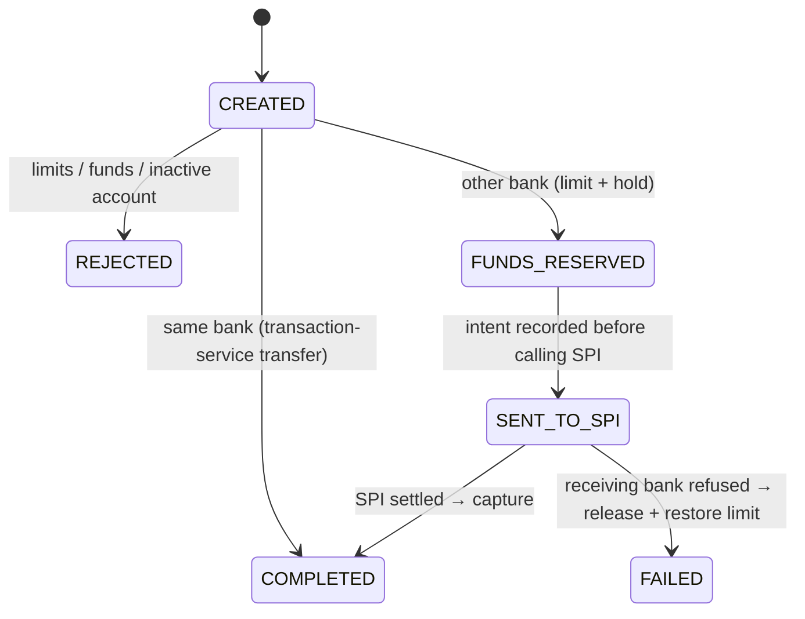

# pix-service

## Responsibility

Pix, the Brazilian instant payment system. Integrations with the Central Bank (**DICT** for keys, **SPI** for settlement) are **simulated** behind ports.

## Capabilities

| Capability | Status |
|---|---|
| Keys: register, list, delete (CPF, email, phone `+55DD9XXXXXXXX`, random EVP). Max 5 per account; a CPF key must be the holder's CPF | ✅ |
| Key lookup: receiver name, masked document (`***.982.247-**`), bank | ✅ |
| Transfer to a customer of this bank (one-step saga) | ✅ |
| Transfer to another bank: reserve → SPI → capture / release | ✅ |
| Incoming transfer from another bank (simulated SPI delivery) | ✅ |
| Keys removed when an account closes (`account.closed` consumer, inbox) | ✅ |
| QR codes: BR Code (EMV QRCPS-MPM + CRC16-CCITT) static or one-time, with amount or open amount, expiry and `txid` | ✅ |
| Paying QR codes, with one-time charges reserved before money moves | ✅ |
| Refunds ("devolução") of received Pix, partial or full, within 90 days | ✅ |
| Dynamic QR codes: the BR Code carries a URL; the charge is served as a JWS signed by the bank and verified by the payer | ✅ |
| Scheduled Pix (a future date) and recurring Pix (weekly / monthly), cancellable | ✅ |
| Pix Automático: receiver-requested, payer-approved mandates with a maximum and a frequency; charges paid on their due dates | ✅ |
| Contacts: recent receivers derived from completed outgoing transfers (no copy kept), plus up to 50 favorites with a nickname (the key must resolve and not be the account's own) | ✅ |

## Outgoing Transfer Flow

- Every downstream call is idempotent: transaction keys are `pix:<transfer id>` (outgoing) and `pix-in:<E2E id>` (incoming), and SPI is idempotent on the E2E ID.
- A lease on the transfer row serializes processing; a recovery worker resumes transfers stuck in `CREATED`, `FUNDS_RESERVED` or `SENT_TO_SPI` (for example when transaction-service was down).
- `SENT_TO_SPI` is saved **before** calling SPI, so after a crash the worker asks SPI again (same E2E ID) instead of guessing.

## QR Codes (BR Code)

`CreateQrCode` renders the "Pix copia e cola" string: TLV fields (`00` format, `01` initiation `11` static / `12` one-time, `26` merchant account with GUI `br.gov.bcb.pix` and the key, `52` MCC, `53` currency `986`, optional `54` amount, `58` country, `59` name, `60` city, `62.05` txid) closed by a CRC-16/CCITT-FALSE checksum in `63`. Names are uppercased ASCII without accents and truncated to the spec's limits.

Paying a code:

1. `DecodeQrCode` checks the checksum and structure, resolves the receiver, and for charges issued here checks the code still matches what was issued (key, amount), is not expired, and is not paid.
2. `PayQrCode` creates the transfer, then **claims** the charge (`UPDATE … WHERE paid_transfer_id IS NULL`) before any money moves. A second payer of a one-time code is refused with `QR_CODE_UNAVAILABLE`.
3. If the payment fails (no funds, refused), the claim is released in the same transaction that marks the transfer failed, so the charge can be paid again.

## Dynamic QR Codes

A dynamic code does not contain the key or the amount, only a URL (`26.25`), e.g. `pix.digitalbank.example/pix/qr/v2/<txid>`. The payer's bank:

1. fetches the URL and gets a compact **JWS** (EdDSA) whose claims follow the Central Bank's Pix API (`txid`, `chave`, `valor.original`, `status`, `calendario`, `solicitacaoPagador`);
2. fetches the receiver bank's JWKS (`/pix/qr/jwks.json`) and verifies the signature;
3. pays only if the status is `ATIVA`; once paid, the endpoint serves the charge as `CONCLUIDA`.

A forged payload (another key, even with the right `kid`) is rejected. The signing key is an Ed25519 key derived from a kms-service data key (`pix-service/qr-signing`). Both endpoints are public, as other banks must reach them.

## Scheduled, Recurring and Automatic Pix

- **Schedules** run on São Paulo dates. Monthly dates are computed from the first date and clamped to the month's end (the 31st runs on Feb 28 and on Mar 31 again).
- A worker (every 30 s) locks each due schedule with `FOR UPDATE SKIP LOCKED`, sends the Pix with the key `sched:<id>:<n>` and records the run, in one transaction: replicas never run an occurrence twice, and a crash mid-run is retried with the same key. A refused occurrence (no funds) is recorded and the schedule moves on.
- **Pix Automático**: the receiver requests a mandate for a payer's key (max amount, weekly or monthly); the payer approves or rejects; the receiver then charges at most once per period and never above the maximum. Each charge is a schedule on its due date. Revoking cancels pending charges, and a charge whose mandate is no longer active is skipped at execution.

## Refunds

A completed incoming Pix can be refunded, fully or in parts, for 90 days. The refund is an outgoing transfer to the payer through the usual reserve → SPI → capture flow.

- The original row is locked while the refund is created, and its `refunded_amount` is increased in the same transaction. Concurrent refunds can never add up to more than was received; a `CHECK (refunded_amount <= amount)` constraint backs this up in the database.
- A refund that fails gives its reservation back, atomically with its status change, so retries never release twice.
- Refunds appear in the statement as `PIX_REFUND`.
- **Same-bank Pix.** When a Pix between two of our customers completes, the receiver gets an incoming record (counterparty: the sender, ISPB of this bank) written in the same transaction, so it can be listed and refunded like any received Pix. Its refund is an internal transfer back to the payer. Money returned by a refund cannot itself be refunded.
- The end-to-end id is unique per direction (`UNIQUE (end_to_end_id, direction)`): the sender's and the receiver's records of a same-bank Pix share it.

## Simulators

The Central Bank systems are behind ports (`Directory`, `SPI`) with in-memory simulators:

| Key | Behaviour |
|---|---|
| `maria@outrobanco.com.br`, `+5511987654321` | Accounts at "Banco Exemplo" (ISPB 12345678); payments settle |
| `recusa@outrobanco.com.br` | The receiving bank rejects every payment (`RECEIVER_BANK_REJECTED`) |

`SimulateIncoming` plays the SPI delivering a Pix from another bank to one of our keys.

## gRPC API

Defined in [`contracts/proto/bank/pix/v1/pix.proto`](../../contracts/proto/bank/pix/v1/pix.proto).

| Method | Description |
|---|---|
| `RegisterKey` / `DeleteKey` / `ListKeys` | Key management |
| `LookupKey` | Resolve a key |
| `CreateTransfer` | Send a Pix (idempotent on `idempotency_key`) |
| `GetTransfer` | Transfer status |
| `ListTransfers` | Sent and/or received Pix of an account, cursor-paginated |
| `SimulateIncoming` | Simulated SPI delivery |
| `CreateQrCode` / `DecodeQrCode` / `PayQrCode` | BR Code charges |
| `RefundTransfer` | Refund a received Pix |
| `GetDynamicQrPayload` / `GetQrJwks` | Signed payload and verification keys of dynamic codes |
| `CreateSchedule` / `ListSchedules` / `CancelSchedule` / `RunDueSchedules` | Scheduled and recurring Pix |
| `RequestMandate` / `DecideMandate` / `RevokeMandate` / `ListMandates` / `ChargeMandate` | Pix Automático |

## Events

| Publishes (`bank.pix.events`) | Consumes |
|---|---|
| `pix.key.registered`, `pix.key.deleted` | `account.closed` (remove keys) |
| `pix.transfer.completed`, `pix.transfer.failed`, `pix.transfer.received` | |

## Dependencies

- `account-service` (gRPC): holder name, document and status
- `transaction-service` (gRPC): transfers, reservations, credits

## Data

`pix_keys`, `pix_transfers` (with `qr_txid`, `refund_of`, `refunded_amount`), `qr_codes`, `pix_schedules`, `pix_schedule_runs`, `pix_mandates`, `data_keys`, `outbox`, `inbox`. Every transfer stores its `end_to_end_id` (E2E ID), the unique identifier of a Pix payment.
