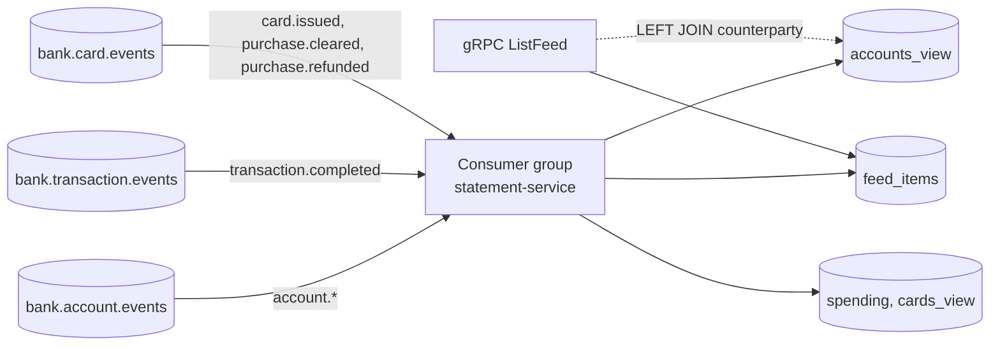

# statement-service

## Responsibility

The **read side** (CQRS) for everything the customer sees in their feed and statements. It consumes events from all domains and builds denormalized projections.

## Capabilities

| Capability | Status |
|---|---|
| Unified feed of completed transactions (transfers, Pix out, Pix in, same-bank Pix), cursor-paginated, newest first | ✅ |
| Counterparty names (from Pix metadata, or the local holder projection) | ✅ |
| Spending by month (Brasília time): card purchases (debit and credit, from `card.purchase.cleared`) by category from the merchant category code, Pix and transfers sent, bills paid; refunds subtract from their purchase's category; previous month and top merchants (`GetSpending`) | ✅ |
| Monthly budgets per category or on the month's total (`SetBudget` / `ListBudgets`, with what was spent); reaching 80% and 100% in the current month publishes `statement.budget.threshold` once each (recorded in `budget_alerts`, sent through the transactional outbox to `bank.statement.events`; locking the budget row serializes two expenses so an alert is never missed; a late event of a past month alerts nobody). Budgets are owned data, not rebuilt from events | ✅ |
| Receipts for every item, with an authentication code: the item id plus an HMAC-SHA256 tag (80 bits) of what the receipt states under the bank's key (`RECEIPT_KEY`), so it is checked without storing anything and cannot be forged or edited; public check with names masked | ✅ |
| Period filter on the feed, used by the CSV export | ✅ |
| Search and text filters | planned |

## How It Works

- **Which sides get items.** `INTERNAL_TRANSFER`: a debit for the sender and a credit for the receiver. `PIX_OUT`: a debit for the sender. `PIX_IN`: a credit for the receiver. Bank-internal accounts (Pix settlement) never appear.
- **Out-of-order events.** The counterparty name is resolved at read time from `accounts_view`, so a transaction projected before the receiver's `account.opened` still shows the name later.
- **Idempotency.** Every event is recorded in the `inbox` in the same transaction as its rows, and `feed_items` is unique on `(account_id, transaction_id)`.
- **Rebuild.** The projection is disposable: truncate the tables and start a new consumer group (`CONSUMER_GROUP`) to replay the topics from the beginning.
- **Query.** One index range scan on `(account_id, occurred_at DESC, id DESC)` with a keyset cursor (no `OFFSET`).
- **Consistency.** Eventual. In the local stack, items appear within a few hundred milliseconds.

## gRPC API

| Method | Description |
|---|---|
| `ListFeed` | Paginated transaction feed |
| `GetReceipt` / `VerifyReceipt` | A receipt of an account's item / the public check of an authentication code |
| `GetSpending` | A month's spending by category, previous month's total, top five merchants |
| `SetBudget` / `ListBudgets` | Monthly budgets (amount 0 removes one) with the month's spending against them |

- **Spending sources.** Card purchases come from card events (one source for debit and credit; the debit transaction is not counted again); `PIX_OUT` and `INTERNAL_TRANSFER` count as *Pix e transferências*, `BOLETO_PAYMENT` as *Contas*; paying the card invoice and moving money to savings are not spending. Older card events without the account are placed through `cards_view` (from `card.issued`).

## Data

`accounts_view`, `feed_items`, `inbox`.
