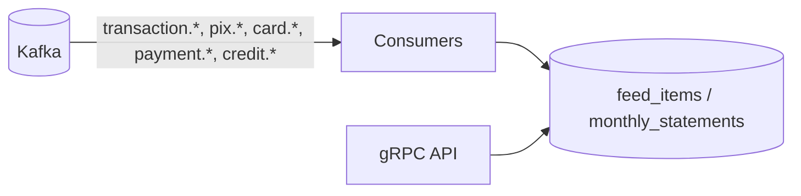

# statement-service

## Responsibility

The **read side** (CQRS) for everything the customer sees in their feed and statements. It consumes events from all domains and builds denormalized projections.

## Capabilities

- Unified transaction feed (Pix, card, boleto, transfers, invoice payments) with cursor pagination
- Search and filters (type, period, amount, counterparty)
- Monthly statements with opening and closing balances
- PDF / CSV export
- Transaction receipts

## How It Works

- Projections can be **rebuilt from scratch** by replaying topics from the beginning.
- Consumers are idempotent (inbox table keyed by event ID).
- Eventual consistency target: p95 < 1 s, p99 < 3 s between the transaction and its appearance in the feed.
- Feed query target: p99 < 100 ms (single indexed lookup on `(account_id, occurred_at DESC)`, cursor pagination).
- The first feed page is cached in Redis per account and invalidated on new events.

## gRPC API

| Method | Description |
|---|---|
| `ListFeed` | Paginated transaction feed |
| `GetFeedItem` | Item details |
| `GetMonthlyStatement` | Statement for a month |
| `ExportStatement` | Generate PDF or CSV |

## Events

| Publishes | Consumes |
|---|---|
| `statement.monthly.generated` | `transaction.*`, `pix.transfer.*`, `card.authorization.approved`, `payment.boleto.paid`, `credit.invoice.*`, `ledger.entry.posted`, `user.profile.updated` |

## Data

`feed_items`, `monthly_statements`, `inbox`.
