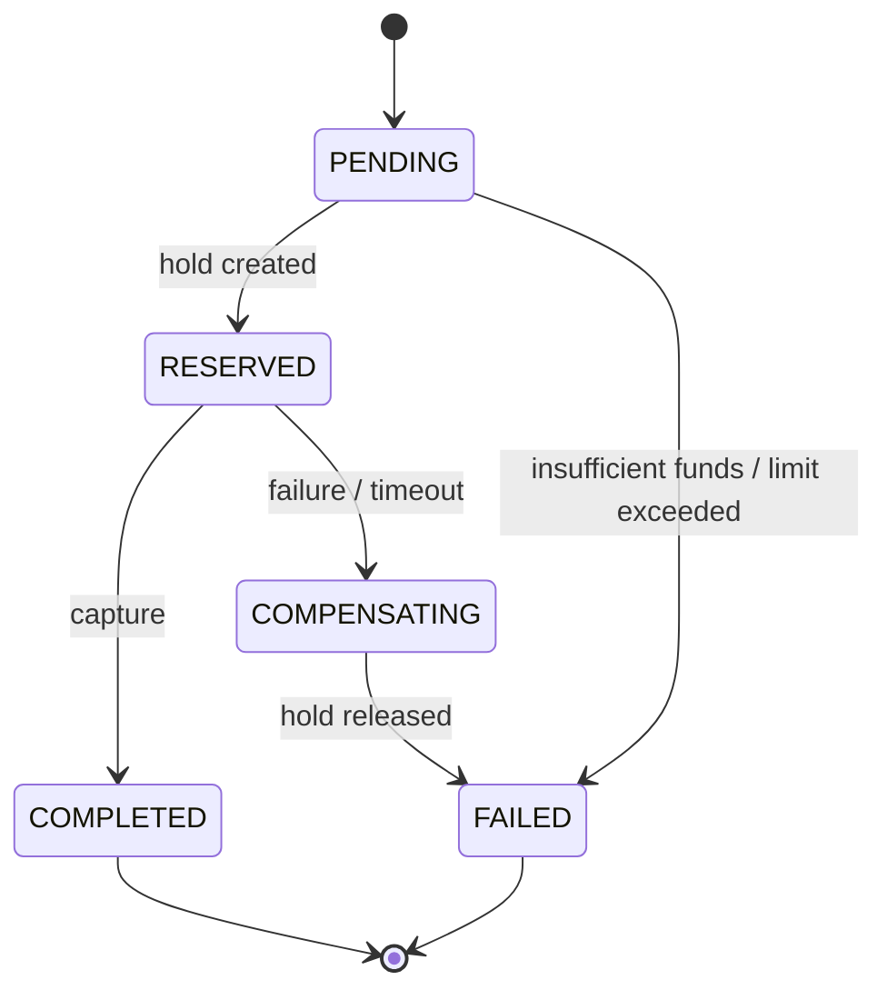

# transaction-service

## Responsibility

Orchestrates money movements that involve more than one step or service, using **sagas** ([ADR-0008](../decisions/0008-orchestrated-sagas.md)).

## Transaction Types

| Type | Initiated by | Steps |
|---|---|---|
| `INTERNAL_TRANSFER` | app | check limits → post entry |
| `PIX_OUT` | pix-service | check limits → hold → (SPI) → capture / release |
| `PIX_IN` | pix-service | post entry |
| `BOLETO_PAYMENT` | payment-service | check limits → hold → (settlement) → capture / release |
| `DEBIT_CARD_PURCHASE` | card-service | hold → (clearing) → capture / release |
| `INVOICE_PAYMENT` | credit-service | post entry (checking → credit) |

## State Machine

## gRPC API

| Method | Description |
|---|---|
| `StartTransaction` | Start a saga (idempotent on `idempotency_key`) |
| `CompleteTransaction` | Confirm the external step |
| `CompensateTransaction` | Roll back |
| `GetTransaction` | Current state |

## Events

| Publishes | Consumes |
|---|---|
| `transaction.initiated` | — |
| `transaction.completed` | |
| `transaction.failed` | |

## Reliability

- Saga state and step log are persisted (`transactions`, `saga_steps`).
- A recovery worker resumes sagas stuck in intermediate states after a timeout.
- Every step and compensation is idempotent.

## Dependencies

- `ledger-service` (gRPC)
- `account-service` (gRPC, limit checks)
