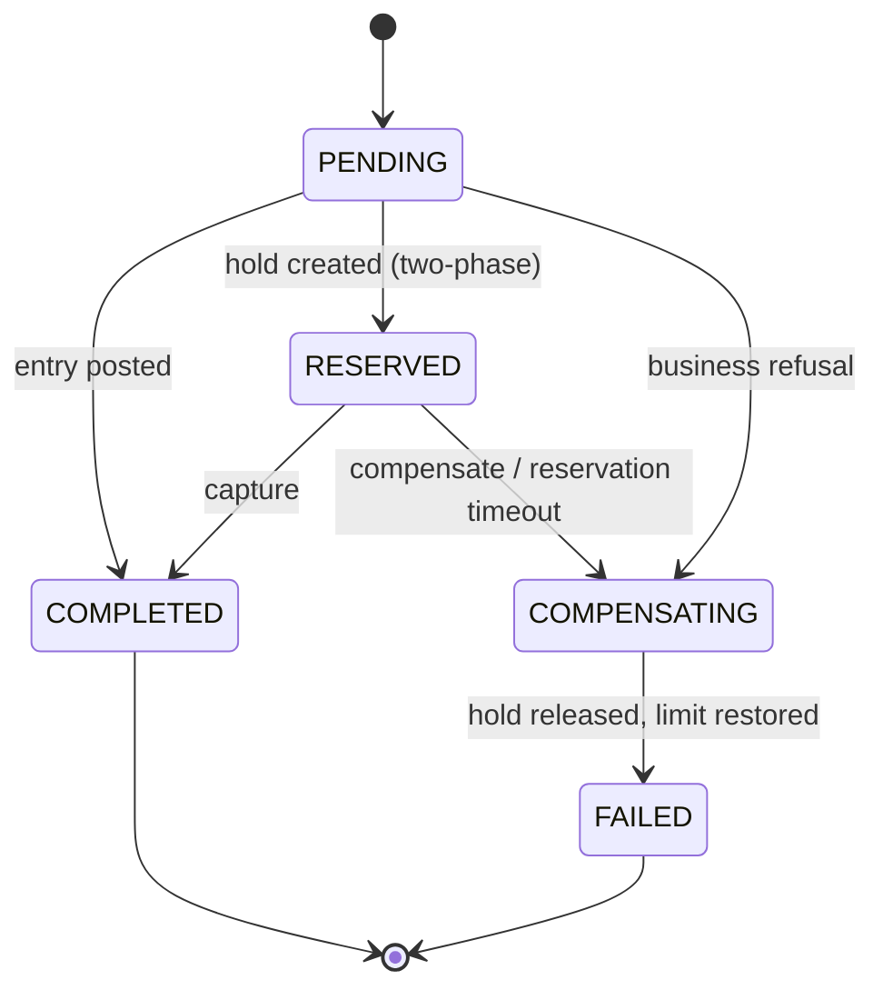

# transaction-service

## Responsibility

Orchestrates money movements that involve more than one step or service, using **sagas** ([ADR-0008](../decisions/0008-orchestrated-sagas.md)).

## Transaction Types

| Type | Initiated by | Steps |
|---|---|---|
| `INTERNAL_TRANSFER` | app | check destination → consume limit → post entry |
| `PIX_OUT` | pix-service | consume limit → hold → *(SPI)* → capture / release + restore limit |
| `PIX_IN` | pix-service | check destination → post entry |

Planned: `BOLETO_PAYMENT`, `DEBIT_CARD_PURCHASE`, `INVOICE_PAYMENT`.

## State Machine

## How the Saga Stays Correct

- **Idempotent steps.** Downstream keys derive from the transaction ID (`txn:<id>:entry`, `txn:<id>:hold`, limit usage keyed by `<id>`), so replaying a step returns the original result.
- **Business vs technical failures.** A refusal (`INSUFFICIENT_FUNDS`, `LIMIT_EXCEEDED`, `DESTINATION_NOT_ACTIVE`...) compensates and ends `FAILED`. A technical error (timeout, service down) leaves the saga where it is and returns `UNAVAILABLE`; the caller can retry with the same key.
- **No blind compensation.** A `PENDING` saga is never compensated from outside: its last step may have succeeded with the response lost. It only moves forward.
- **Leases.** One runner owns a saga at a time (`locked_until`), so a client retry and the recovery worker never run it concurrently.
- **Recovery worker.** Every few seconds it resumes `PENDING`/`COMPENSATING` sagas untouched for 10 s, and compensates `RESERVED` ones older than 15 min (`RESERVATION_TIMEOUT`).
- **Audit.** Every step outcome is recorded in `saga_steps`.

## gRPC API

Defined in [`contracts/proto/bank/transaction/v1/transaction.proto`](../../contracts/proto/bank/transaction/v1/transaction.proto).

| Method | Description |
|---|---|
| `CreateTransfer` | Internal transfer (idempotent on `idempotency_key`) |
| `ReserveOutgoing` | Limit + hold, ends `RESERVED` |
| `CompleteTransaction` | Capture the hold |
| `CompensateTransaction` | Release the hold and restore the limit |
| `CreditIncoming` | Credit money arriving from outside |
| `GetTransaction` | Current state |

## Events

| Publishes | Consumes |
|---|---|
| `transaction.initiated` | — |
| `transaction.completed` | |
| `transaction.failed` | |

## Dependencies

- `ledger-service` (gRPC)
- `account-service` (gRPC, limit checks)
