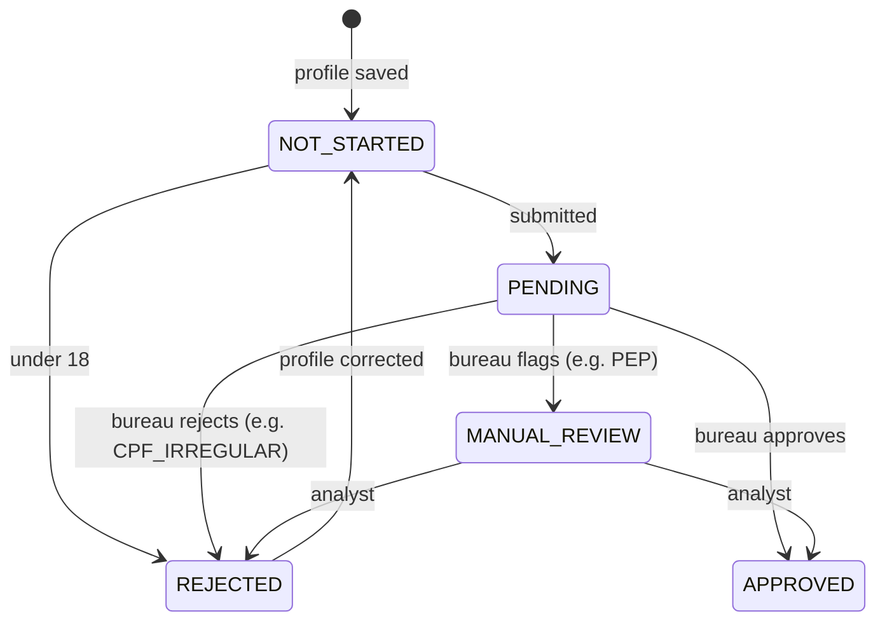

# user-service

## Responsibility

Onboarding: the customer's profile and **KYC** (know your customer). An account can only be opened for a customer this service has verified, and it carries the verified name and CPF.

## Capabilities

| Capability | Status |
|---|---|
| Profile: full name, CPF (check digits), birth date, phone (+55), address (CEP, UF); normalized and validated | ✅ |
| CPF encrypted at rest (AES-GCM, data key unwrapped by kms-service) with a blind index | ✅ |
| One person, one customer: a CPF can be in verification or verified for a single customer (partial unique index on the blind index) | ✅ |
| KYC: under 18 rejected locally; then the identity bureau answers approve, reject (with a reason) or manual review | ✅ |
| Name, CPF and birth date lock once verification starts; contact data stays editable; a rejected profile can be corrected and submitted again | ✅ |
| Bureau down: the verification stays `PENDING` and a worker asks again | ✅ |
| Manual review queue (`ListKycReviews`, oldest first) decided by an analyst in the back office (`ReviewKyc` records `reviewed_by`); the sandbox still lets the customer play the analyst | ✅ |
| account-service asks `GetIdentity` before opening an account (`KYC_REQUIRED`, `DOCUMENT_MISMATCH`) | ✅ |
| Document photos and liveness (selfie), address proof, periodic re-verification | planned |

## KYC States

## Simulated Bureau

| CPF starts with | Answer |
|---|---|
| `111` | Rejected, `CPF_IRREGULAR` |
| `222` | Manual review, `PEP` (politically exposed person) |
| anything else | Approved |

## gRPC API

Defined in [`contracts/proto/bank/user/v1/user.proto`](../../contracts/proto/bank/user/v1/user.proto). Callers: api-gateway, account-service.

| Method | Description |
|---|---|
| `GetProfile` / `UpsertProfile` | Profile (CPF masked in answers) |
| `SubmitKyc` / `ReviewKyc` | Verification |
| `GetIdentity` | Verified identity with the full CPF (account-service) |

## Events

| Publishes (`bank.user.events`) | Consumes |
|---|---|
| `user.kyc.approved`, `user.kyc.rejected`, `user.kyc.review` (notified to the customer) | — |

## Data

`profiles`, `data_keys`, `outbox`.
