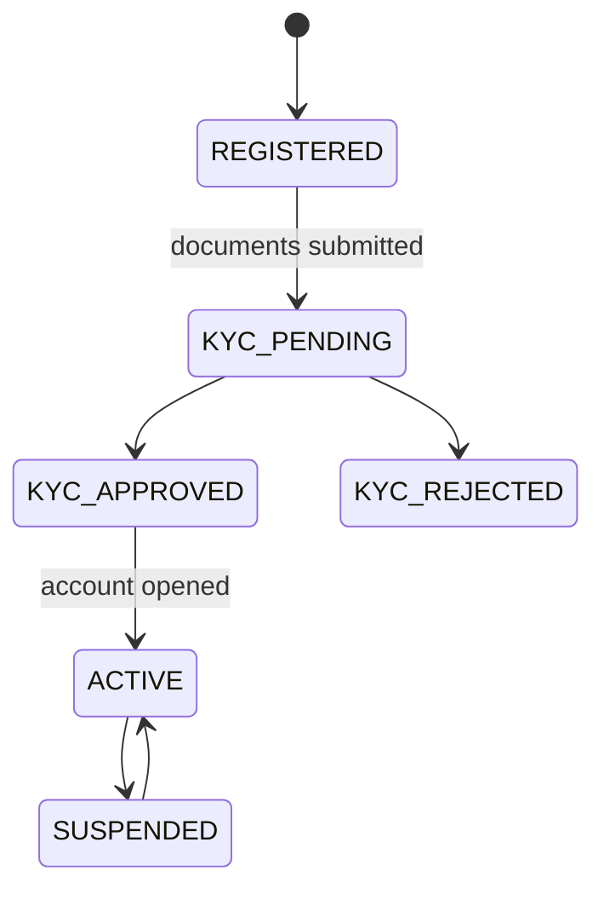

# user-service

## Responsibility

The customer's profile and onboarding, including KYC (Know Your Customer).

## Capabilities

- Sign-up (name, CPF, birth date, email, phone)
- CPF validation and uniqueness
- KYC flow: document upload and selfie (simulated provider), with status tracking
- Profile and address management
- Email and phone verification

## Onboarding State Machine

## gRPC API

| Method | Description |
|---|---|
| `CreateUser` | Register a new customer |
| `GetUser` | Fetch a profile |
| `UpdateProfile` | Update contact data and address |
| `SubmitKyc` | Send KYC documents |

## Events

| Publishes | Consumes |
|---|---|
| `user.registered` | `account.opened` (move to `ACTIVE`) |
| `user.kyc.approved` | |
| `user.kyc.rejected` | |
| `user.profile.updated` | |

## Data

`users`, `addresses`, `kyc_verifications`, `outbox`, `inbox`. PII is encrypted at rest.
